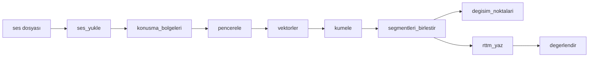

# Modüller Arası Arayüz Sözleşmesi

Bu belge `src/` altındaki modüllerin fonksiyon imzalarını ve veri tiplerini sabitler. Kod taslakları bu belgeyle birebir aynıdır (`python tests/test_arayuz.py` ile kontrol edilir).

## 1. Akış



`src/main.py` bu fonksiyonları sırayla çağırır. Konuşma bölgesi yoksa `pencerele`den sonrası atlanır ve boş RTTM yazılır.

## 2. Ortak tipler ve sabitler

| Ad | Tanım |
|---|---|
| `SR` | Örnekleme hızı sabiti: `16000` Hz (`src/ses_girdi.py`) |
| ses | `np.ndarray`, şekil `(n_ornek,)`, `float32`, değerler `[-1, 1]`, mono |
| bölge / pencere | `(baslangic_sn: float, bitis_sn: float)` |
| segment | `(baslangic_sn: float, bitis_sn: float, etiket: str)`, etiket `"spk00"`, `"spk01"`, ... |
| gömme matrisi `X` | `np.ndarray`, şekil `(N, D)`, `float32`; MFCC için `D=26`, ECAPA için `D=192` |
| etiketler | `np.ndarray`, şekil `(N,)`, `int` |

Zaman her yerde **saniye** (float). Sıralama her listede zamana göredir.

## 3. Modüller

### 3.1 `src/ses_girdi.py` (sahibi: Abdullah)

```python
ses_yukle(yol: str) -> tuple[np.ndarray, int]
```
- `yol`: wav/mp3/flac dosya yolu.
- Dönüş: `(ses, 16000)`; ses mono (kanal ortalaması), `float32`, şekil `(n_ornek,)`, RMS yaklaşık -20 dBFS.
- Hata: `FileNotFoundError` (dosya yok), `ValueError` (bozuk veya desteklenmeyen biçim; mesajda dosya adı geçer).

### 3.2 `src/vad.py` (sahibi: Abdullah)

```python
konusma_bolgeleri(ses: np.ndarray, sr: int) -> list[tuple[float, float]]
```
- `ses`: yukarıdaki ses tipi; `sr`: 16000.
- Dönüş: konuşma bölgeleri (saniye), sıralı, örtüşmeyen. Konuşma yoksa `[]`.

### 3.3 `src/oznitelik.py` (sahibi: Abdullah)

```python
pencerele(bolgeler: list[tuple[float, float]], pencere_sn: float = 1.5, kaydirma_sn: float = 0.75) -> list[tuple[float, float]]
vektorler(ses: np.ndarray, sr: int, pencereler: list[tuple[float, float]], yontem: str = "mfcc") -> np.ndarray
```
- `pencerele`: her bölge kendi içinde `pencere_sn` uzunlukta, `kaydirma_sn` adımla pencerelenir; pencere bölge sınırını aşmaz. `pencere_sn`den kısa bölge tek pencere olur. Boş girdi için `[]`. Hata: `ValueError` (`pencere_sn <= 0` veya `kaydirma_sn <= 0`).
- `vektorler`: `yontem` `"mfcc"` (13 katsayının ortalaması + std, `D=26`) veya `"ecapa"` (`D=192`). Dönüş şekli `(N, D)`, `float32`, `N = len(pencereler)`; pencere yoksa `(0, D)`. Hata: `ValueError` (bilinmeyen `yontem`).

### 3.4 `src/kumeleme.py` (sahibi: Cevat)

```python
kumele(X: np.ndarray, konusmaci_sayisi: int | None = None, esik: float | None = None) -> np.ndarray
```
- Yöntem: ortalama bağlantılı AHC, kosinüs mesafesi (gerekçe: Hafta2 C-4 bölümü).
- `X`: `(N, D)`, `float32`. `konusmaci_sayisi`: biliniyorsa verilir, `None` ise `esik` ile otomatik kestirilir (tek konuşmacıda 1 küme çıkabilir, TG-6). `esik`: kosinüs mesafesi eşiği, `None` ise `VARSAYILAN_ESIK` (VoxConverse dev üzerinde ayarlanacak, KG-3).
- Dönüş: `(N,)` `int` etiketler (`0..K-1`). `N == 0` ise boş dizi, `N == 1` ise `[0]`.
- Hata: `ValueError` (`X` iki boyutlu değil veya `konusmaci_sayisi < 1`).

### 3.5 `src/cikti.py` (sahibi: Cevat)

```python
segmentleri_birlestir(pencereler: list[tuple[float, float]], etiketler: np.ndarray, ada_esik_sn: float = 1.0, bosluk_sn: float = 0.3) -> list[tuple[float, float, str]]
degisim_noktalari(segmentler: list[tuple[float, float, str]]) -> list[float]
rttm_yaz(segmentler: list[tuple[float, float, str]], dosya_id: str, yol: str) -> None
rttm_oku(yol: str) -> list[tuple[float, float, str]]
tablo_yazdir(segmentler: list[tuple[float, float, str]]) -> str
```
- `segmentleri_birlestir`: ardışık aynı etiketli pencereler tek segmentte birleşir. Örtüşen farklı etiketli iki pencerede sınır, örtüşmenin ortasıdır. Önce süresi `ada_esik_sn`'den kısa ve iki yanı aynı etiketli koşular (A-B-A) komşu etikete katılır (KG-10). Aynı etiketli iki segment arasındaki boşluk `bosluk_sn`'den (0,3 sn, VAD min. sessizlikle aynı) kısaysa birleşir; daha uzun boşluk segmente girmez (KG-11). Etiketler toplam konuşma süresine göre azalan sırada `spk00`, `spk01`, ... diye adlandırılır. Hata: `ValueError` (`len(pencereler) != len(etiketler)`).
- `degisim_noktalari`: ardışık iki segmentin etiketi farklıysa ikincinin başlangıcı (saniye, artan). 0 veya 1 segmentte `[]`.
- `rttm_yaz`: 10 alanlı RTTM, `SPEAKER <dosya_id> 1 <başlangıç> <süre> <NA> <NA> <etiket> <NA> <NA>`; alan 5 süredir (bitiş değil), 3 ondalık. `dosya_id` uzantısız dosya adıdır. Segment yoksa boş dosya yazar. Hata: `OSError`.
- `rttm_oku`: dosyadaki sırayla `(bas, bit, etiket)` döner (`bit = bas + süre`). Boş dosyada `[]`. Hata: `FileNotFoundError`, `ValueError` (satır biçimi bozuk).
- `tablo_yazdir`: `Konuşmacı | Başlangıç | Bitiş | Süre` sütunlu metin, zamanlar `dd:ss.mmm`; altında konuşmacı başına toplam süre ve yüzde (KG-14).

### 3.6 `src/degerlendirme.py` (sahibi: Sefkan)

```python
degerlendir(ref_rttm: str, hyp_rttm: str, collar: float = 0.5, tolerans_sn: float = 0.5) -> dict
```
- `collar`: pyannote.metrics biçiminde tam genişlik (0.5 = ±0,25 sn). `tolerans_sn`: değişim noktası eşleşme toleransı.
- Dönüş: `{"der": float, "jer": float, "f1": float}`; DER/JER oran olarak (0.25 = %25), `f1` değişim noktası F1'i (0-1). Örtüşen konuşma dahildir.
- Hata: `FileNotFoundError`, `ValueError` (RTTM biçimi bozuk).

### 3.7 `src/main.py` (sahibi: Cevat)

```python
main(argv: list[str] | None = None) -> int
```
Komut satırı: `python -m src.main <girdi_ses> -o <cikti.rttm> [--yontem mfcc|ecapa] [--konusmaci-sayisi N]`

| Çıkış kodu | Anlamı |
|---|---|
| 0 | Başarılı (sessiz dosyada boş RTTM de başarılıdır) |
| 1 | Girdi hatası: `FileNotFoundError` veya `ValueError`; stderr'e dosya adı içeren mesaj yazılır |
| 2 | İç hata: diğer tüm istisnalar |

## 4. Kenar durumlar

- **Kısa dosya / kısa konuşma (1,5 sn'den az):** Hata verilmez. Uyarı yazılır, tüm konuşma tek segment sayılır, tek konuşmacı (`spk00`) atanır, çıkış kodu 0. Bu durumda `main` kümelemeyi hiç çağırmaz; VAD bölgelerinin her biri `spk00` etiketiyle doğrudan segment olur. (Ayrıca `kumele`, `N == 1` için `[0]` döner.)
- **Sessiz dosya:** `konusma_bolgeleri` `[]` döner, `main` boş RTTM yazar, çıkış kodu 0.
- **Bozuk veya desteklenmeyen dosya:** `ses_yukle` `ValueError` fırlatır (dosya yoksa `FileNotFoundError`); `main` çıkış kodu 1 ile döner ve mesajda dosya adı bulunur.
- **Örtüşen konuşma:** İlk sürümde tespit edilmez; her segment tek konuşmacıya atanır. Bilinen sınırlamadır.
- **Maksimum süre (300 sn):** Açık nokta, ekip toplantısında karara bağlanacak.

## 5. Değişiklik kuralı

İmza, tip veya hata davranışı değişikliği önce **bu dosyada PR ile** yapılır, onaylanınca kod uyarlanır. Taslak kodlar ve `tests/test_arayuz.py` bu belgeyle aynı kalmalıdır.
