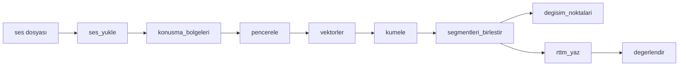

# Modüller Arası Arayüz Sözleşmesi

Bu belge `src/` altındaki modüllerin fonksiyon imzalarını ve veri tiplerini sabitler. Kod taslakları bu belgeyle birebir aynıdır (`python tests/test_arayuz.py` ile kontrol edilir).

## 1. Akış



`src/main.py` bu fonksiyonları sırayla çağırır. Konuşma bölgesi yoksa `pencerele`den sonrası atlanır ve boş RTTM yazılır.

Toplu deneyler (`src/toplu.py`, 3.9) aynı adımları önbellekle çalıştırır: `bolme` (eğitim/değerlendirme yarıları) → önbellek (VAD + MFCC + ECAPA) → eşik taraması ve değişim modeli eğitimi (eğitim yarısı) → E1–E5 (değerlendirme yarısı) → `degerlendir` → CSV ve özet.

## 2. Ortak tipler ve sabitler

| Ad | Tanım |
|---|---|
| `SR` | Örnekleme hızı sabiti: `16000` Hz (`src/ses_girdi.py`) |
| ses | `np.ndarray`, şekil `(n_ornek,)`, `float32`, değerler `[-1, 1]`, mono |
| bölge / pencere | `(baslangic_sn: float, bitis_sn: float)` |
| segment | `(baslangic_sn: float, bitis_sn: float, etiket: str)`, etiket `"spk00"`, `"spk01"`, ... |
| gömme matrisi `X` | `np.ndarray`, şekil `(N, D)`, `float32`; MFCC için `D=26`, ECAPA için `D=192` |
| etiketler | `np.ndarray`, şekil `(N,)`, `int` |

Zaman her yerde **saniye** (float). Sıralama her listede zamana göredir.

## 3. Modüller

### 3.1 `src/ses_girdi.py` (sahibi: Abdullah)

```python
ses_yukle(yol: str, maks_sure_sn: float | None = MAKS_SURE_SN) -> tuple[np.ndarray, int]
```
- `yol`: wav/mp3/flac dosya yolu.
- Dönüş: `(ses, 16000)`; ses mono (kanal ortalaması), `float32`, şekil `(n_ornek,)`, RMS yaklaşık -20 dBFS. Tepe değer 0,99'u geçmez (gerekirse RMS -20 dBFS'in altında kalır). wav/flac `soundfile`, mp3 `librosa` ile okunur; 16 kHz dışındaki sesler yeniden örneklenir. Sessiz (sıfır) ses hata değildir, değiştirilmeden döner.
- `maks_sure_sn`: en uzun girdi süresi (sn); varsayılan `MAKS_SURE_SN = 1800`, `None` = sınırsız. Süre mümkünse dosya okunmadan başlıktan denetlenir (wav: RIFF başlığı, `wav_denetle`; flac: `soundfile.info`; mp3: `librosa.get_duration`), okumadan sonra gerçek uzunlukla bir kez daha.
- Hata: `FileNotFoundError` (dosya yok), `ValueError` (bozuk veya desteklenmeyen biçim, ya da süre sınırı aşıldı: `"<ad>: süre <s> sn, en fazla <m> sn kabul ediliyor"`; mesajda dosya adı geçer).

```python
on_isle(veri: np.ndarray, sr_girdi: int) -> np.ndarray
```
- `ses_yukle`'nin okuma sonrası ön işlemesi: `veri` `(n_ornek,)` veya `(n_ornek, kanal)`; mono, 16 kHz, RMS ≈ -20 dBFS, tepe ≤ 0,99; `float32`, `(n_ornek,)`. Bellekte okunmuş sesler (ör. zip içinden, `src/toplu.py`) aynı işlemden geçsin diye açıktır. Hata: `ValueError` (boş ses, NaN/sonsuz değer, geçersiz örnekleme hızı).

```python
wav_denetle(kaynak: str | bytes, ad: str | None = None) -> float
```
- WAV (RIFF) başlığını standart kütüphaneyle (`struct`) denetler, başlıktaki süreyi (sn) döndürür. `kaynak`: dosya yolu veya dosyanın baytları (zip içinden okunan WAV). `ses_yukle` her `.wav` dosyasında, `toplu.SesKaynagi` her zip kaydında okumadan önce çağırır; soundfile kesik dosyayı hata vermeden kısaltıp okuduğu için bu denetim gereklidir (Hafta 4 duman testi: `bozuk_yarim.wav` çıkış 0 veriyordu).
- `ValueError` (mesajda dosya adı): RIFF/WAVE imzası yok; `fmt` veya `data` bölümü yok ya da `data` `fmt`'den önce; `fmt` alanları geçersiz (kanal / örnekleme hızı / blok hizası 0, blok hizası kanal × örnek genişliğiyle uyuşmuyor); `data`'dan önceki bir bölüm dosya sonunu aşıyor; **`data` bölümünün bildirdiği boyut dosyada kalan bayttan bir örnek çerçevesinden (blok hizası) fazla büyük** (yarıda kesilmiş dosya; mesajda başlıktaki ve gerçek süre).

### 3.2 `src/vad.py` (sahibi: Abdullah)

```python
konusma_bolgeleri(ses: np.ndarray, sr: int) -> list[tuple[float, float]]
```
- `ses`: yukarıdaki ses tipi; `sr`: 16000.
- Dönüş: konuşma bölgeleri (saniye), sıralı, örtüşmeyen. Konuşma yoksa `[]`.
- Silero VAD (`load_silero_vad(onnx=True)`), min. konuşma 250 ms, min. sessizlik 300 ms; model modülde bir kez yüklenir.

### 3.3 `src/oznitelik.py` (sahibi: Abdullah)

```python
pencerele(bolgeler: list[tuple[float, float]], pencere_sn: float = 1.5, kaydirma_sn: float = 0.75) -> list[tuple[float, float]]
vektorler(ses: np.ndarray, sr: int, pencereler: list[tuple[float, float]], yontem: str = "mfcc") -> np.ndarray
```
- `pencerele`: her bölge kendi içinde `pencere_sn` uzunlukta, `kaydirma_sn` adımla pencerelenir; pencere bölge sınırını aşmaz. `pencere_sn`den kısa bölge tek pencere olur. Bölgenin sonu açıkta kalırsa son pencere bölge sonuna hizalanır (bölgenin tamamı kapsanır). Boş girdi için `[]`. Hata: `ValueError` (`pencere_sn <= 0` veya `kaydirma_sn <= 0`).
- `vektorler`: `yontem` `"mfcc"` (13 katsayının ortalaması + std, `D=26`) veya `"ecapa"` (`D=192`). Dönüş şekli `(N, D)`, `float32`, `N = len(pencereler)`; pencere yoksa `(0, D)`. Hata: `ValueError` (bilinmeyen `yontem`).
  - `"mfcc"`: librosa MFCC, `n_fft=512`, `win_length=400`, `hop_length=160`. **c0 (enerji) atılır, c1–c13 kullanılır** (`n_mfcc=14` hesaplanıp ilki düşülür); 13 katsayının ortalaması + std = 26 boyut.
  - `"ecapa"`: SpeechBrain `speechbrain/spkrec-ecapa-voxceleb` (`speechbrain.inference.speaker.EncoderClassifier`), pencereler toplu işlenir, GPU varsa kullanılır.

```python
ecapa_modeli(onbellek: str | None = None) -> EncoderClassifier
```
- ECAPA modelini bir kez yükler, modülde saklar ve döndürür. Model klasörü: `onbellek` parametresi, yoksa `KT_MODEL_ONBELLEK` ortam değişkeni, o da yoksa `~/.cache/konusmaci-tespiti/ecapa`. Colab'da modeli Drive'daki bir klasörden önceden yüklemek için kullanılır; model zaten yüklüyse `onbellek` yok sayılır.

```python
olcek_hesapla(X_listesi: list[np.ndarray]) -> dict
olcekle(X: np.ndarray, olcek: dict | None) -> np.ndarray
```
- **MFCC genel standartlaştırma.** `olcek_hesapla`: verilen tüm matrislerin pencerelerinden boyut başına ortalama ve standart sapma (std alt sınırı 1e-8); dönüş `{"ortalama": [D], "std": [D], "pencere_sayisi": n}`. Hata: `ValueError` (hiç pencere yok). `olcekle`: `(X - ortalama) / std`, `float32`; `olcek` `None` ise `X` değişmez.
- Ölçek **yalnızca eğitim yarısının** tüm MFCC pencerelerinden hesaplanır ve değerlendirme yarısında aynısı kullanılır. **Kayıt başına ortalama çıkarılmaz** (tek konuşmacılı kayıtları bölebilir). Gerekçe: c0'sız MFCC ortalama+std vektörleri ortak bir yönde toplanır, L2 normalize kosinüs mesafeleri çok küçük kalır (Hafta 4 duman testi: 0,5 eşikle her kayıtta 1 konuşmacı). Ölçek önbelleğe yazılmaz; önbellekte ham MFCC durur.
- Uygulandığı yerler: E1/E2 kümelemesi (`esikler.json` → `mfcc_olcek`), eşik taraması (MFCC), değişim modelinin `mfcc_cos` özelliği (`degisim_modeli.joblib` → `mfcc_olcek`). `src/main.py` tek dosya komutu MFCC'de `src/varsayilanlar.json` içindeki ölçeği uygular (3.12).

### 3.4 `src/kumeleme.py` (sahibi: Cevat)

```python
kumele(X: np.ndarray, konusmaci_sayisi: int | None = None, esik: float | None = None) -> np.ndarray
```
- Yöntem: ortalama bağlantılı AHC, kosinüs mesafesi (gerekçe: Hafta2 C-4 bölümü).
- `X`: `(N, D)`, `float32`. `konusmaci_sayisi`: biliniyorsa verilir, `None` ise `esik` ile otomatik kestirilir (tek konuşmacıda 1 küme çıkabilir, TG-6). `esik`: kosinüs mesafesi eşiği, `None` ise `VARSAYILAN_ESIK` (VoxConverse dev üzerinde ayarlanacak, KG-3).
- Vektörler önce L2 ile normalize edilir. `konusmaci_sayisi` verilirse scipy `fcluster(criterion="maxclust")`, verilmezse `criterion="distance"` kullanılır.
- `VARSAYILAN_ESIK` = `varsayilanlar.esik("ecapa")` (0,79346; Hafta 4'te VoxConverse dev eğitim yarısında ayarlandı, 3.12). `kumele` yöntemi bilmediği için `esik=None`'da varsayılan yöntemin (ECAPA) eşiğini kullanır; MFCC eşiği `varsayilanlar.esik("mfcc")` (0,77122) ile çağıran tarafından verilir (`main`, `toplu`).
- Dönüş: `(N,)` `int` etiketler (`0..K-1`). `N == 0` ise boş dizi, `N == 1` ise `[0]`.
- Hata: `ValueError` (`X` iki boyutlu değil veya `konusmaci_sayisi < 1`).

### 3.5 `src/cikti.py` (sahibi: Cevat)

```python
segmentleri_birlestir(pencereler: list[tuple[float, float]], etiketler: np.ndarray, ada_esik_sn: float = 1.0, bosluk_sn: float = 0.3) -> list[tuple[float, float, str]]
degisim_noktalari(segmentler: list[tuple[float, float, str]]) -> list[float]
rttm_yaz(segmentler: list[tuple[float, float, str]], dosya_id: str, yol: str) -> None
rttm_oku(yol: str) -> list[tuple[float, float, str]]
tablo_yazdir(segmentler: list[tuple[float, float, str]]) -> str
```
- `segmentleri_birlestir`: ardışık aynı etiketli pencereler tek segmentte birleşir. Örtüşen farklı etiketli iki pencerede sınır, örtüşmenin ortasıdır. Önce süresi `ada_esik_sn`'den kısa ve iki yanı aynı etiketli koşular (A-B-A) komşu etikete katılır (KG-10); en kısa koşu önce işlenir. Ada yumuşatmada komşuluk segment sırasına göredir; segmentler arasındaki sessizlik boşluğu dikkate alınmaz. Aynı etiketli iki segment arasındaki boşluk en fazla `bosluk_sn` ise (≤ 0,3 sn, VAD min. sessizlikle aynı) birleşir; daha uzun boşluk segmente girmez (KG-11). Etiketler toplam konuşma süresine göre azalan sırada `spk00`, `spk01`, ... diye adlandırılır. Hata: `ValueError` (`len(pencereler) != len(etiketler)`).
- `degisim_noktalari`: ardışık iki segmentin etiketi farklıysa ikincinin başlangıcı (saniye, artan). 0 veya 1 segmentte `[]`. Hesap milisaniye çözünürlüğünde, aşağıdaki ortak tanımla yapılır. Örtüşmeyen segmentlerde (sistem çıktısı) sonuç yukarıdaki cümleyle aynıdır. Örtüşen segmentlerde (referans RTTM) örtüşen aralıklar atılır.
- `rttm_yaz`: 10 alanlı RTTM, `SPEAKER <dosya_id> 1 <başlangıç> <süre> <NA> <NA> <etiket> <NA> <NA>`; alan 5 süredir (bitiş değil), 3 ondalık. `dosya_id` uzantısız dosya adıdır. Segment yoksa boş dosya yazar. Hata: `OSError`.
- `rttm_oku`: dosyadaki sırayla `(bas, bit, etiket)` döner (`bit = bas + süre`). Boş dosyada `[]`. Boş satırlar, `;` veya `#` ile başlayan satırlar ve `SPEAKER` dışındaki satırlar atlanır; süresi 0 olan segment atlanır. Hata: `FileNotFoundError`, `ValueError` (satır biçimi bozuk: 8'den az alan, sayısal olmayan başlangıç/süre, negatif zaman veya süre).
- `tablo_yazdir`: `Konuşmacı | Başlangıç | Bitiş | Süre` sütunlu metin, zamanlar `dd:ss.mmm` (dakika:saniye.milisaniye); altında konuşmacı başına toplam süre ve yüzde (KG-14).

**Ortak değişim noktası tanımı** (yalnızca standart kütüphane, tüm zamanlar tamsayı milisaniye). `degisim_noktalari`, `src/degerlendirme.py` ve `data/tools/rttm_istatistik.py` bu iki fonksiyonu kullanır; tanım başka yerde kopyalanmaz.

```python
temel_araliklar(segmentler_ms: list[tuple[int, int, str]]) -> list[tuple[int, int, frozenset]]
tek_konusmaci_segmentleri(segmentler_ms: list[tuple[int, int, str]]) -> list[tuple[int, int, str]]
```
- `temel_araliklar`: zaman eksenini segment sınırlarına göre böler; her aralık için etkin etiket kümesini verir (boş küme = sessizlik).
- `tek_konusmaci_segmentleri`: örtüşen (≥ 2 konuşmacı) ve sessiz aralıkları atar; aynı konuşmacının ardışık tek konuşmacılı aralıklarını (arada sessizlik veya örtüşme olsa bile) birleştirir. Ardışık iki çıktı segmentinin etiketi farklıdır; ilki hariç her segmentin başlangıcı bir değişim noktasıdır.

### 3.6 `src/degerlendirme.py` (sahibi: Sefkan)

```python
degerlendir(ref_rttm: str, hyp_rttm: str, collar: float = 0.5, tolerans_sn: float = 0.5) -> dict
```
- `collar`: pyannote.metrics biçiminde tam genişlik (0.5 = ±0,25 sn). `tolerans_sn`: değişim noktası eşleşme toleransı.
- DER ve JER pyannote.metrics ile, `skip_overlap=False` (örtüşen konuşma dahil) hesaplanır. Değerlendirme bölgesi (UEM) dosya başından (0 sn) referans ve tahmindeki en geç bitişe kadardır.
- Dönüş sözlüğü:

| Anahtar | Tip | Anlamı |
|---|---|---|
| `der`, `jer` | float | Oran (0.25 = %25). Referansta konuşma yoksa (`referans_sn == 0`) **NaN** |
| `yanlis_alarm_sn` | float | Yanlış alarm süresi (sn) |
| `kacirilan_sn` | float | Kaçırılan konuşma süresi (sn) |
| `karisiklik_sn` | float | Konuşmacı karışıklığı süresi (sn) |
| `referans_sn` | float | pyannote `total`: collar dışındaki referans konuşma süresi, örtüşmede konuşmacı başına sayılır. Tüm kayıtlar için DER = Σ(yanlis_alarm + kacirilan + karisiklik) / Σ referans_sn |
| `f1`, `precision`, `recall` | float | Değişim noktası F1 / kesinlik / duyarlık (0-1) |
| `tp`, `fp`, `fn` | int | Eşleşen, fazla ve kaçırılan değişim noktası sayısı (tüm kayıtlarda mikro F1 için) |

- Değişim noktaları referans ve tahmin RTTM'inden `cikti.degisim_noktalari` (ortak tanım, 3.5) ile çıkarılır. Her referans noktası en fazla bir tahminle eşleşir; `|r - h| <= tolerans_sn` olan çiftlerden en yakınları önce eşleşir.
- Kenar durumlar: tahminde değişim noktası yoksa `precision = 1`, referansta yoksa `recall = 1`; `precision + recall == 0` ise `f1 = 0`. Sessiz referans + değişimsiz tahmin: `f1 = 1`. Sessiz referans + sahte değişimler: `f1 = 0`. Bu yüzden toplu sonuçta dosya ortalaması yerine `tp/fp/fn` toplamlarıyla mikro F1 kullanılır.
- Hata: `FileNotFoundError`, `ValueError` (RTTM biçimi bozuk; ayrıca `collar < 0` veya `tolerans_sn < 0`).

### 3.7 `src/main.py` (sahibi: Cevat)

```python
main(argv: list[str] | None = None) -> int
```
Komut satırı: `python -m src.main <girdi_ses> -o <cikti.rttm> [--yontem ecapa|mfcc] [--konusmaci-sayisi N] [--esik E] [--maks-sure SN]`

- `--maks-sure`: en uzun girdi süresi (sn), varsayılan `ses_girdi.MAKS_SURE_SN` (1800); `0` = sınırsız. Aşan dosya çıkış kodu 1 verir (mesajda dosya adı ve süre).

- `--yontem`: varsayılan **`ecapa`** (Hafta 4 değerlendirme yarısında en iyi sonuç: E4, DER 0,061). `mfcc` seçenek olarak kalır.
- `--esik`: AHC kosinüs mesafesi eşiği. Verilmezse (ve `--konusmaci-sayisi` yoksa) yöntemin ayarlanmış eşiği kullanılır: `varsayilanlar.esik(yontem)` (ecapa 0,79346, mfcc 0,77122). `--konusmaci-sayisi` verilirse eşik kullanılmaz.
- MFCC'de vektörler kümelemeden önce `varsayilanlar.mfcc_olcek()` ile standartlaştırılır; ölçek henüz dosyada yoksa ham MFCC kullanılır ve uyarı yazılır.

| Çıkış kodu | Anlamı |
|---|---|
| 0 | Başarılı (sessiz dosyada boş RTTM de başarılıdır) |
| 1 | Girdi hatası: `FileNotFoundError` veya `ValueError`; stderr'e dosya adı içeren mesaj yazılır |
| 2 | İç hata: diğer tüm istisnalar |

```python
kisa_konusma(bolgeler: list[tuple[float, float]]) -> bool
hat_segmentleri(bolgeler, pencereler, X, konusmaci_sayisi=None, esik=None) -> list[tuple[float, float, str]]
segmentleri_hesapla(girdi: str, yontem: str = "ecapa", konusmaci_sayisi: int | None = None,
                    esik: float | None = None, maks_sure_sn: float | None = 1800) -> tuple[list[tuple[float, float, str]], float]
```
- `hat_ayrintili(girdi, yontem="ecapa", konusmaci_sayisi=None, esik=None, maks_sure_sn=1800) -> dict`: tek dosyalık hattın tamamı; ara bilgileri de döndürür: `{"segmentler", "ses_sn", "ses", "sr", "bolgeler"` (VAD), `"pencereler", "X"` (kümelenen vektörler; kısa/sessiz kayıtta `None`), `"esik"` (kullanılan; konuşmacı sayısı verildiyse `None`), `"sureler": {"okuma", "vad", "oznitelik", "kumeleme"}}` (sn). Web arayüzü bunu kullanır.
- `segmentleri_hesapla`: `hat_ayrintili`'nin `(segmentler, ses_sn)` kısmı; dosya yazmaz, ekrana basmaz. Eşik ve MFCC ölçeği kuralları `--esik` ile aynıdır. Hata: `FileNotFoundError`, `ValueError` (`ses_yukle` ile aynı). `main` (RTTM yazıp tabloyu basar) ve web arayüzü (3.15) bunu kullanır.
- `kisa_konusma`: toplam konuşma `MIN_KONUSMA_SN` (1,5 sn) altında mı.
- `hat_segmentleri`: konuşma yoksa `[]`; kısa konuşmada kümeleme atlanır, her bölge `spk00` olur (`pencereler` ve `X` kullanılmaz); aksi halde `kumele` + `segmentleri_birlestir`. `main` ve `toplu` aynı kuralı bu fonksiyonla uygular.

### 3.8 `src/bolme.py` (sahibi: Sefkan)

```python
grup(sayi: int) -> str
konusmaci_sayilari(rttm_dizin: str) -> dict[str, int]
bol(sayilar: dict[str, int], seed: int = 68) -> tuple[list[str], list[str]]
liste_yaz(kayitlar: list[str], yol: str) -> None
liste_oku(yol: str) -> list[str]
```
Komut satırı: `python -m src.bolme --rttm-dizin <voxconverse/dev> --cikti-dizin <klasor> [--seed 68]` → `egitim.txt`, `degerlendirme.txt`.
- `grup`: `"1"` (0 veya 1 konuşmacı), `"2"`, `"3-4"`, `"5+"`.
- `konusmaci_sayilari`: klasördeki her `<kayit>.rttm` için farklı etiket sayısı; kayıt kimliği dosya adıdır. Hata: `FileNotFoundError` (klasör yok), `ValueError` (RTTM bozuk).
- `bol`: tabakalı bölme. Her tabaka sıralanır, `random.Random(seed)` ile karıştırılır ve ikiye ayrılır; tek sayılı tabakalarda artan kayıt sırayla bir eğitime, bir değerlendirmeye verilir. Dönüş: `(egitim, degerlendirme)`, ikisi de sıralı. Aynı girdi her zaman aynı bölmeyi verir.
- `liste_oku`: boş satırlar ve `#` ile başlayanlar atlanır.

### 3.9 `src/toplu.py` (sahibi: Sefkan)

Komut satırı (bir iş seçilir; çıkış kodu 0 başarılı, 1 girdi hatası veya en az bir kayıt hatalı, 2 iç hata):

```text
python -m src.toplu --deney E1|E2|E3|E4|E5 --zip Z --rttm-dizin R --liste L [L ...] --cikti-dizin C --onbellek O [--esik X | --esikler J] [--model M]
python -m src.toplu --onbellek-doldur --zip Z --liste L [L ...] --onbellek O [--yontemler mfcc ecapa] [--cikti-dizin C]
python -m src.toplu --esik-tara --zip Z --rttm-dizin R --liste L --onbellek O --esikler J [--cikti-dizin C]
python -m src.toplu --model-egit --zip Z --rttm-dizin R --liste L --onbellek O --model M [--cikti-dizin C]
```

| Deney | Öznitelik | Konuşmacı ataması |
|---|---|---|
| E1 | MFCC | AHC, konuşmacı sayısı referans RTTM'den |
| E2 | MFCC | AHC, eşikle |
| E3 | ECAPA | AHC, konuşmacı sayısı referans RTTM'den |
| E4 | ECAPA | AHC, eşikle |
| E5 | ECAPA (+ MFCC özelliği) | Değişim modeli segmentleri + AHC (ECAPA eşiğiyle) |

Eşik önceliği (E2/E4/E5): `--esik` > `--esikler` dosyasındaki yöntem eşiği > `varsayilanlar.esik(yontem)` (E5: ecapa). E1/E2'de MFCC ölçeği önceliği: `--esikler` dosyasının `mfcc_olcek` alanı > `varsayilanlar.mfcc_olcek()`; ikisi de yoksa ham MFCC kullanılır ve uyarı yazılır. `deney_calistir` doğrudan çağrılırsa `esik=None` yöntemin ayarlanmış eşiği, `mfcc_olcek=None` ham MFCC demektir.

```python
class SesKaynagi(zip_yol)                       # .oku(kayit) -> (ses, 16000); bağlam yöneticisi
onbellek_anahtarlari() -> dict[str, str]
onbellek_yolu(onbellek: str, tur: str, kayit: str) -> str
ozellik_al(kaynak, kayit, onbellek, yontemler=("mfcc", "ecapa")) -> dict
onbellek_doldur(zip_yol, kayitlar, onbellek, yontemler=("mfcc", "ecapa"), gunluk_dizin=None, log=print) -> dict
deney_calistir(zip_yol, rttm_dizin, kayitlar, deney, cikti_dizin, onbellek, esik=None, model_yolu=None, mfcc_olcek=None, log=print) -> dict
esik_tara(zip_yol, rttm_dizin, kayitlar, onbellek, yontemler=("mfcc", "ecapa"), izgara=None, gunluk_dizin=None, log=print) -> dict
yuzdelik_izgarasi(yukseklikler, n: int = 40) -> list[float]
esikleri_yaz(yol: str, sonuc: dict) -> None
esikleri_oku(yol: str) -> dict
model_egit(zip_yol, rttm_dizin, kayitlar, onbellek, model_yolu, gunluk_dizin=None, log=print) -> dict
ozet_hesapla(satirlar: list[dict]) -> dict
ozet_yaz(yol: str, ozet: dict) -> None
listeleri_oku(yollar: list[str]) -> list[str]
main(argv: list[str] | None = None) -> int
```
- **Ses okuma:** WAV zip'ten `ZipFile.read` ile belleğe alınır ve `soundfile` ile `BytesIO`'dan okunur; zip açılmaz. Okunamazsa geçici dosyaya yazılıp `ses_yukle` ile okunur ve silinir. Ön işleme `ses_girdi.on_isle` ile `ses_yukle` ile aynıdır. **Süre sınırı (`MAKS_SURE_SN`) uygulanmaz:** toplu iş bilinen bir veri kümesini işler (VoxConverse dev'de en uzun kayıt ~1100 sn).
- **Önbellek:** `{onbellek}/<tur>/<anahtar>/<kayit>.npz`, `tur` ∈ {`vad`, `mfcc`, `ecapa`}. `<anahtar>` hesaplamayı etkileyen parametreleri içerir (ör. `p1.5_k0.75_v250_s300_mfcc13c1_f512_w400_h160`); her anahtar klasöründe `parametreler.json` durur. `vad` dosyası: `bolgeler (K, 2)`, `ses_sn`, `sure_sn`. `mfcc`/`ecapa` dosyası: `pencereler (N, 2)`, `X (N, D) float32`, `sure_sn`. Dosya önce geçici adla yazılıp `os.replace` ile konur; yarım dosya geçerli sayılmaz, okunamayan dosya yeniden hesaplanır.
- **Kayıt CSV'si** `{cikti}/<deney>.csv`, ilk beş sütun sabit: `deney, kayit, der, jer, f1`; ardından `precision, recall, tp, fp, fn, yanlis_alarm_sn, kacirilan_sn, karisiklik_sn, referans_sn, ses_sn, sure_sn`. `sure_sn` = öznitelik hesaplama süresi (önbellekte saklı) + deneyin kendi süresi. Hipotez RTTM'leri `{cikti}/<deney>/<kayit>.rttm`. CSV'de olan kayıtlar yeniden çalıştırmada atlanır. Değerlendirme `collar=0.5`, `tolerans_sn=0.5`.
- **Özet** `{cikti}/ozet.csv` sütunları: `deney, kayit_sayisi, der, jer_ort, mikro_f1, toplam_sure_sn, toplam_ses_sn, atlanan`. `der` = Σ(yanlış alarm + kaçırılan + karışıklık) / Σ `referans_sn`; `jer_ort` NaN'lar dışarıda ortalama; `mikro_f1` Σtp/Σfp/Σfn'den. Aynı deneyin satırı yeniden çalıştırmada değiştirilir.
- **Hatalar:** hata veren kayıt atlanır, `{cikti}/hata_gunlugu.txt` dosyasına yazılır (`--cikti-dizin` yoksa önbellek klasörüne), iş sürer.
- **`esik_tara` (veriden ızgara):** yöntem başına eğitim kayıtlarının AHC birleşme yükseklikleri (bağlantı mesafeleri) toplanır; aday eşikler bunların `YUZDELIK_SAYISI` = 40 yüzdeliğidir (`yuzdelik_izgarasi`): %1–%99 arası, `q = 100 − geomspace(99, 1, 40)` ile üst uca doğru sıklaşır, çünkü konuşmacılar arası birleşmeler her kaydın en yüksek birkaç birleşmesidir. MFCC önce genel ölçekle standartlaştırılır. Bağlantı ağacı kayıt başına bir kez kurulur, her eşikte kesilir. Seçim: en düşük toplam DER, eşitlikte büyük eşik. **En iyi eşik ızgaranın kenarına düşerse** o yönde genişletilip yeniden taranır (1. tur: %0,01–%1 veya %99–%99,99 yüzdelikleri ve en küçük yüksekliğin 0,9 katı / en büyüğün 1,01 katı; sonraki turlar: kenar değerin 0,8/0,6/0,4 veya 1,1/1,25/1,5 katı, en çok 2,0; en çok `GENISLETME_TURU` = 3 tur); her genişletme ve hâlâ kenarda kalma `uyarilar`'a yazılır. `izgara` açıkça verilirse yalnızca o değerler taranır, genişletme yapılmaz.
- `esikler.json`: `{"mfcc": x, "ecapa": y, "mfcc_olcek": {"ortalama", "std", "pencere_sayisi"}, "tarama": [{yontem, esik, der, jer_ort, mikro_f1}], "izgara": {yontem: [...]}, "genisletme": {yontem: n}, "kayit_sayisi", "hatali", "uyarilar", "collar", "tarih"}`.

### 3.10 `src/degisim_modeli.py` (sahibi: Sefkan)

```python
OZELLIK_SURUMU = "v2"
OZELLIKLER = ("ecapa_cos", "ecapa_baglam_cos", "ecapa_atlamali_cos", "mfcc_cos", "bosluk_sn", "ayni_bolge")
ozellikler(pencereler, X_ecapa, X_mfcc, bolgeler, k: int = 3) -> np.ndarray          # (N-1, 6) float32
cift_zamanlari(pencereler) -> np.ndarray                                             # (N-1,)
baskin_konusmacilar(pencereler, ref_segmentler, oran: float = 0.5) -> list[str | None]
cift_etiketleri(baskin: list) -> tuple[np.ndarray, np.ndarray]                       # (y, maske)
tepeler(olasiliklar, zamanlar, esik: float, min_aralik_sn: float) -> list[float]
kayit_verisi(kayit, pencereler, X_ecapa, X_mfcc, bolgeler, ref_segmentler, k: int = 3) -> dict
egit(veriler: list[dict], seed: int = 68, n_kat: int = 5, log=print) -> dict
kaydet(paket: dict, yol: str) -> None
yukle(yol: str) -> dict
degisim_tahmin(paket, pencereler, X_ecapa, X_mfcc, bolgeler) -> list[float]
bolgeleri_kes(bolgeler, degisimler) -> list[tuple[float, float]]
e5_segmentleri(paket, bolgeler, pencereler, X_ecapa, X_mfcc, esik: float | None = None) -> list[tuple[float, float, str]]
```
- **Özellikler** (ardışık pencere çifti i, i+1; sürüm `v2`, sıra sabit): `ecapa_cos` = cos(eᵢ, eᵢ₊₁); `ecapa_baglam_cos` = cos(ort(eᵢ₋ₖ₊₁..eᵢ), ort(eᵢ₊₁..eᵢ₊ₖ)), k=3, dizi sınırında kırpılır; `ecapa_atlamali_cos` = cos(eᵢ₋₁, eᵢ₊₂); `mfcc_cos` = cos(mᵢ, mᵢ₊₁), m genel ölçekli MFCC (v2; v1'de ham MFCC); `bosluk_sn` = sᵢ₊₁ − bᵢ (negatif = örtüşme); `ayni_bolge` = iki pencerenin merkezi aynı VAD bölgesinde mi. ECAPA vektörleri L2 ile normalize edilir.
- **Etiket tanımı:** her pencerenin *baskın konuşmacısı*, referans RTTM'de pencereyle en çok örtüşen konuşmacıdır (aynı konuşmacının segmentleri birleştirilerek ölçülür; eşitlikte alfabetik ilk). Baskın konuşmacı pencerenin **yarısından azını** kaplıyorsa pencere *belirsizdir* (`None`). Çift etiketi: baskın konuşmacılar farklıysa 1, aynıysa 0. Pencerelerden biri belirsizse çift eğitimden çıkarılır (`maske = False`).
- **Değişim zamanı:** çiftin örtüşme bölgesinin ortası, `(bᵢ + sᵢ₊₁) / 2`; pencereler arasında boşluk varsa aynı formül boşluğun ortasını verir.
- **Tepe seçme:** olasılığı eşiği geçen yerel tepeler; en yüksek olasılıklı tepe önce seçilir, seçilmiş bir tepeye `min_aralik_sn`'den yakın olanlar bastırılır.
- **Eğitim (`egit`):** yalnızca eğitim yarısı. Adaylar: lojistik regresyon (`StandardScaler`, `class_weight="balanced"`, C ∈ {0,1; 1; 10}) ve MLP (`StandardScaler`, gizli (32) veya (64, 32), alpha ∈ {1e-4, 1e-3}, `early_stopping`). Seçim: kayıt bazında gruplu 5 katlı çapraz doğrulamada (`GroupKFold`) ortalama kesinlik (average precision); eşitlikte listede önce gelen. Seçilen model tüm eğitim yarısında yeniden eğitilir. Tepe ayarları seçilen modelin kat dışı olasılıklarıyla taranır: olasılık eşiği 0,10–0,90 (0,05 adım) × en küçük aralık {0,5; 1; 1,5; 2} sn; ölçüt ±0,5 sn toleranslı mikro değişim F1'i. Hata: `ValueError` (< 2 etiketli kayıt veya tek sınıf).
- **Paket** (joblib, tek dosya): `model` (ölçekleyici içeren sklearn pipeline), `secilen_model`, `mfcc_olcek` (eğitim yarısından genel MFCC ölçeği; `degisim_tahmin` ham MFCC'ye bunu uygular), `ozellik_surumu`, `ozellikler`, `baglam_k`, `baskin_oran`, `olasilik_esigi`, `min_aralik_sn`, `tolerans_sn`, `egitim_f1`, `tepe_tarama`, `uyarilar` (seçilen olasılık eşiği veya en küçük aralık ızgaranın kenarındaysa uyarı metinleri; eşik taramasındaki mantık), `cv` (aday başına `ap_ort`, `ap_std`, `katlar`), `egitim_tarihi`, `egitim_kayit_sayisi`, `egitim_cift_sayisi`, `degisim_orani`, `sklearn_surumu`, `seed`. `yukle`, özellik sürümü uyuşmazsa `ValueError` verir. Model dosyası repoya girmez.
- **E5 (`e5_segmentleri`):** VAD bölgeleri, içlerine düşen tahmin edilmiş değişim noktalarından parçalara bölünür (VAD sınırları da segment sınırıdır). Her parçanın vektörü, merkezi parçanın içine düşen pencerelerin normalize ECAPA ortalamasıdır (hiç yoksa en yakın pencere). Parçalar `kumele(V, None, esik)` ile etiketlenir ve `segmentleri_birlestir`'den geçer. Sessizlik ve kısa konuşma kuralları `hat_segmentleri` ile aynıdır.

### 3.11 `src/uyumluluk.py` (sahibi: Sefkan)

```python
speechbrain_hazirla() -> list[str]
```
- **Neden:** speechbrain 1.0.3, içe aktarılırken (`speechbrain/dataio/dataio.py` modül düzeyinde `check_torchaudio_backend()`) `torchaudio.list_audio_backends()` çağırır. Bu fonksiyon torchaudio 2.9'da kaldırıldı; Colab'daki torch/torchaudio 2.11 ile `import speechbrain…` `AttributeError` verir. Aynı kontrol torchaudio < 2.1 için `set_audio_backend()` çağırır.
- **Ne yapar:** `torchaudio`'yu içe aktarır; `list_audio_backends` yoksa `["soundfile"]` döndüren, `set_audio_backend` yoksa hiçbir şey yapmayan bir fonksiyon atar. Var olan fonksiyonlara dokunmaz, tekrar çağrılabilir. Dönüş: bu çağrıda eklenen adlar. Hata: `ImportError` (torchaudio yok).
- **Kural:** speechbrain'i içe aktaran her yer önce bunu çağırır: `oznitelik.ecapa_modeli`, `tests/kurulum_kontrol.py`, `tests/test_oznitelik.py`, defterin 1. bölümü.
- **Etkisi yok:** speechbrain v1.0.3 kaynağında kontrol edildi: `EncoderClassifier.from_hparams` (`Fbank`, `InputNormalization`, `ECAPA_TDNN`, `CategoricalEncoder`, `Pretrainer`) ve `encode_batch` akışında başka `torchaudio` çağrısı yoktur. `torchaudio.load` yalnızca `load_audio` / `classify_file` gibi dosya yolu alan yardımcılarda geçer; hattımız sesi `soundfile`/`librosa` ile okuyup ECAPA'ya tensör verir, bunları kullanmaz.

### 3.12 `src/varsayilanlar.py` ve `src/varsayilanlar.json` (sahibi: Sefkan)

```python
yukle() -> dict
esik(yontem: str) -> float
mfcc_olcek() -> dict | None
```
- `src/varsayilanlar.json`, eğitim yarısında ayarlanan değerlerin tek kaynağıdır: `{"kaynak", "tarih", "esik": {"mfcc", "ecapa"}, "e5_esik", "e5_esik_kaynak", "mfcc_olcek": {"ortalama": [26], "std": [26], "pencere_sayisi"} | null}`. `e5_esik` (0,70): E5 hattının (`degisim_modeli.e5_segmentleri`) AHC eşiği; kaynak Hafta 5, eğitim yarısında seçildi. `yukle` bu alanı denetlemez; E4/E1–E3 varsayılanları (`esik`) bundan etkilenmez. Değerler `src.toplu --esik-tara` çıktısından (`esikler.json`) alınır; defterin 10. bölümü bu dosyanın içeriğini tek satırlık JSON olarak basar ("REPO SABİTLERİ").
- `yukle`: dosyayı bir kez okur ve denetler. Hata: `ValueError` (iki yöntemin eşiği yok veya pozitif değil; `mfcc_olcek` 26 ortalama ve 26 pozitif std içermiyor). `esik`: yöntemin eşiği; bilinmeyen yöntemde `ValueError`. `mfcc_olcek`: ölçek veya henüz doldurulmadıysa `None`.
- Kullananlar: `kumeleme.VARSAYILAN_ESIK`, `main.calistir`, `toplu.deney_calistir` ve `toplu` komut satırı (`--esikler` verilmediğinde).
- Hafta 4 değerleri (tarama tarihi 2026-10-27): eşik mfcc 0,77122, ecapa 0,79346 (eşik taramasında uyarı yok); MFCC ölçeği eğitim yarısının 42 520 penceresinden (26 ortalama, 26 std).

### 3.13 `src/gorsel.py` (sahibi: Sefkan)

```python
zaman_cizelgesi(ref_rttm: str, hyp_rttm: str, png_yolu: str, baslik: str | None = None) -> str
zaman_seritleri(seritler: dict[str, list[tuple[float, float, str]]], png_yolu: str, baslik: str | None = None) -> str
renk_haritasi(etiketler) -> dict[str, str]
sonuc_grafigi(csv_yolu: str | list[str], png_yolu: str) -> str
```
- `renk_haritasi`: `{etiket: "#rrggbb"}`; etiketler sıralanır ve matplotlib `tab10` (≤ 10 konuşmacı) veya `tab20` paletinden sırayla renk alır (paletler `TAB10`/`TAB20` olarak modülde sabit; matplotlib gerekmez). Zaman çizelgesinin her şeridi bu haritayı kullanır; web arayüzü tablolardaki konuşmacı renklerini de buradan alır, böylece çizelge ve tablo renkleri aynıdır.
- `zaman_seritleri`: bellekteki segment listelerini `{şerit adı: segmentler}` sırasıyla alt alta çizer (1 veya daha fazla şerit; çizim kuralları `zaman_cizelgesi` ile aynı). `zaman_cizelgesi` bunu `{"Referans", "Sistem"}` ile çağırır; web arayüzü yalnızca `{"Sistem"}` ya da referans verilmişse ikisini çizer. `baslik` boşsa başlık yazılmaz. Hata: `ValueError` (şerit yok).
- matplotlib fonksiyon içinde import edilir; `pyplot` kullanılmaz, çizim doğrudan Agg tuvaline (`FigureCanvasAgg`) yapılır ve PNG'ye yazılır. Ekranda pencere açılmaz, defterin satır içi arka ucu değişmez. Dönüş: `png_yolu` (klasör yoksa oluşturulur).
- `zaman_cizelgesi`: aynı kaydın referans ve sistem RTTM'ini alt alta iki şeritte çizer (Hafta 2 Şekil 2 gibi): her şeritte konuşmacı başına bir satır, zaman ekseni saniye ve iki şeritte ortak. Referans ve sistem etiketleri eşleştirilmez; renkler her şeritte kendi içinde atanır. Boş RTTM'de şeritte "konuşma yok" yazar. `baslik` verilmezse referans dosyasının adı. Hata: `FileNotFoundError`, `ValueError` (RTTM bozuk).
- `sonuc_grafigi`: deney başına DER, JER ve değişim F1'ini gruplu çubuk grafikle çizer. `csv_yolu`: `ozet.csv` (`der`, `jer_ort`, `mikro_f1` doğrudan), tek bir deney CSV'si (ilk beş sütun `deney, kayit, der, jer, f1`) veya bunların listesi; deney CSV'leri `toplu.ozet_hesapla` ile toplanır (DER toplam saniyelerden, JER NaN'sız ortalama, F1 mikro). Aynı deney birden çok dosyada varsa sonraki geçerlidir. Hata: `FileNotFoundError`, `ValueError` (boş liste, boş veya tanınmayan CSV).
- Defterin 9. bölümü bu iki fonksiyonu kullanır; hata verirlerse defter içindeki yedek çizime düşer.

### 3.14 `src/vad_olcum.py` (sahibi: Sefkan)

Komut satırı: `python -m src.vad_olcum --zip Z --rttm-dizin R --liste L [L ...] --cikti-dizin C [--limit N] [--dinleme-dizin D] [--dinleme-sayisi 5] [--parca-sn 10]` (çıkış kodu 0 başarılı, 1 girdi hatası, 2 iç hata; hata veren kayıt atlanır ve `hata_gunlugu.txt`'ye yazılır).

```python
cercevelerden_bolgeler(kararlar, cerceve_sn: float) -> list[tuple[float, float]]
yumusat(bolgeler, sure_sn: float, min_konusma_ms=250, min_sessizlik_ms=300, kenar_payi_ms=30) -> list[tuple[float, float]]
maske(bolgeler, sure_sn: float, cozunurluk_sn: float = 0.01) -> np.ndarray
hata_olc(ref_maske, hyp_maske, cozunurluk_sn: float = 0.01) -> dict
ozet_hesapla(satirlar: list[dict]) -> list[dict]
webrtc_bolgeleri(ses: np.ndarray, sr: int, agresiflik: int) -> list[tuple[float, float]]
olc(zip_yol, rttm_dizin, kayitlar, cikti_dizin, limit=None, dinleme_dizin=None, dinleme_sayisi=5, parca_sn=10.0, log=print) -> list[dict]
snr_tahmini(ses: np.ndarray, sr: int, bolgeler, min_konusmasiz_sn: float = 1.0) -> tuple[float, float]
dinleme_parcasi(bolgeler, sure_sn: float, uzunluk_sn: float = 10.0) -> tuple[float, float]
dinleme_yaz(zip_yol, satirlar, dinleme_dizin, cikti_dizin, sayi=5, parca_sn=10.0, log=print) -> list[dict]
main(argv: list[str] | None = None) -> int
```
- **VAD'lar:** `silero` = `vad.konusma_bolgeleri` (hattın ayarları; Silero'nun varsayılan 30 ms kenar payı dahil). `webrtc2`, `webrtc3` = WebRTC VAD, 30 ms çerçeve (16 bit PCM; son eksik çerçeve atılır), agresiflik 2 ve 3; kararlar `yumusat` ile Silero ile aynı biçimde işlenir: önce 300 ms'den kısa boşluklar doldurulur, sonra 250 ms'den kısa konuşma atılır, sonra her bölge iki yandan 30 ms genişletilir (`[0, süre]` ile kırpılır, örtüşenler birleşir). Süre karşılaştırmaları tamsayı milisaniyeyle yapılır.
- **Referans:** RTTM segmentlerinin birleşimi = konuşma. Maske süresi `max(ses süresi, son RTTM bitişi)`.
- **Ölçüler** (10 ms çerçeve, tüm kayıtların çerçeveleri toplanarak; kayıt ortalaması değil): `kacirilan_yuzde`, `yanlis_alarm_yuzde`, `toplam_hata_yuzde` referans konuşma süresinin yüzdesi (pyannote detection error rate gibi, DER bileşenleriyle karşılaştırılabilir); `yanlis_alarm_sessiz_yuzde` yanlış alarm / referansta konuşma olmayan süre; `sn_per_saat` toplam işlem süresi / toplam ses süresi (saat; Silero model yükleme süresi hariç).
- **Çıktılar:** `{cikti}/vad_kayitlar.csv` (kayıt × VAD satırları: `vad, kayit, ses_sn, ref_konusma_sn, ref_sessiz_sn, kacirilan_sn, yanlis_alarm_sn, sure_sn`; yapılan kayıt × VAD çiftleri yeniden çalıştırmada atlanır) ve `{cikti}/vad_karsilastirma.csv` (VAD başına: `vad, kayit_sayisi, ses_saat, kacirilan_yuzde, yanlis_alarm_yuzde, toplam_hata_yuzde, yanlis_alarm_sessiz_yuzde, sn_per_saat`; yalnızca verilen liste/limit üzerinden). Süre sınırı (`MAKS_SURE_SN`) uygulanmaz.
- **Gürültülü kayıt adayları (kaba SNR):** `snr_tahmini` Silero'nun konuşma bölgelerinin ortalama gücünü konuşma olmayan bölgelerin ortalama gücüne böler (dB); `(snr_db, konusmasiz_sn)` döner. Konuşma olmayan süre `MIN_KONUSMASIZ_SN` = 1,0 sn'den kısaysa, konuşma yoksa veya güçlerden biri 0 ise `NaN`. Silero satırının `snr_db` ve `konusmasiz_sn` sütunlarına yazılır (WebRTC satırlarında boş). Bu yalnızca sıralama için **kaba bir tahmindir** (konuşma gücü gürültüyü de içerir; müzik/alkış konuşma sayılabilir); son seçim dinleyerek yapılır.
- **Dinleme parçaları:** `--dinleme-dizin` verilirse `dinleme_yaz`, NaN olmayan en düşük SNR'lı `--dinleme-sayisi` kaydı seçer; her birinde `dinleme_parcasi` önünde en uzun sessizlik olan konuşma başlangıcını ortalayan `--parca-sn` uzunluğunda bir parça seçer (ilk yarı konuşma olmayan, ikinci yarı konuşma; dosya sınırında kaydırılır; konuşma yoksa dosyanın başı). Parçalar `<kayit>_<bas>s_snr<x>dB.wav` (16 kHz, `on_isle` sonrası ses) olarak yazılır, liste `{cikti}/dinleme_listesi.csv` (`kayit, snr_db, konusmasiz_sn, bas_sn, bit_sn, dosya`). Yalnızca Colab'da, Drive'a (`Hafta4/dinleme/`).
- Defterin 11. bölümü çalıştırır; 10. bölümün kopyalanacak özeti VAD tablosunu ve dinleme listesini içerir.

### 3.15 `src/arayuz.py` ve `app.py` (web arayüzü)

Başlatma: `python app.py [--share] [--host 127.0.0.1] [--port 7860]` (`--share`: Gradio genel geçici bağlantısı, Colab için). Colab defteri: `notebooks/arayuz_demo.ipynb`.

**Ortam değişkenleri ve güvenlik**

| Değişken | Etkisi |
|---|---|
| `KT_KULLANICI_DB` | Uygulama içi hesapların JSON dosyası (3.18). Yoksa `~/.konusmaci-tespiti/kullanicilar.json`. |
| `KT_KAYIT_ACIK` | `0` ise "Kayıt ol" sekmesi gizlenir ve yeni kayıt reddedilir (yalnızca giriş). Varsayılan açık. `--share` kayıt açıkken kullanılırsa stderr'e "bağlantıyı yalnızca güvendiğin kişilerle paylaş" uyarısı yazılır. |
| `KT_IZINLI_DIZIN` | "Sunucudaki ses yolu" yalnızca bu klasörün altındaki dosyaları açar; tanımlı değilse alan gizlenir ve sunucu yolu reddedilir. |
| `KT_GECMIS_DIZIN` | Analiz geçmişinin kökü; her kullanıcının kayıtları `KT_GECMIS_DIZIN/<kullanıcı kimliği>/` altında (3.17). Tanımlı değilse geçmiş kapalı. |

- **Hesap ve oturum:** Açılışta yalnızca "Giriş yap" ve "Kayıt ol" sekmeleri olan ekran; giriş/kayıt başarılı olunca ana uygulama açılır, "Çıkış" geri döndürür. Oturum anahtarı sunucuda üretilir (bellekte, süre sınırlı; 3.18) ve tarayıcıda `gr.BrowserState` ile tutulur; sayfa yenilenince oturum geçerliyse uygulama doğrudan açılır. **Her işleyici** (analiz, görünüm geçişi, segment seçme/gezinme, adlandırma, indirme, geçmiş) önce oturumu sunucuda doğrular (`Uygulama`); geçersizse işlem yapmadan giriş ekranına döner. Eski ortak şifre (`launch(auth=...)`, `KT_KULLANICI`/`KT_SIFRE`) kaldırıldı.
- **API kapalı:** tüm olaylar `api_visibility="private"`; `launch(footer_links=["gradio", "settings"], mcp_server=False)` ile API bağlantısı gösterilmez. Gradio istemci kitaplıkları uç noktaları çağıramaz (testle doğrulanır).
- **Dosya sunma:** `launch(allowed_paths=...)` kullanılmaz (izinli/geçmiş klasörleri dışarıya açılmasın diye). Ses oynatıcının dosyası `oynatilabilir_kopya` ile geçici klasöre kopyalanır; indirme dosyaları geçici klasörde üretilir; hepsi yalnızca oturumu doğrulanmış işleyicilerden döner.
- **Görünürlük:** gradio 6.17.3'te iç içe sütunlarda `visible` güncellemeleri güvenilir olmadığından (başlangıçta `visible=False` olan bileşene yeniden `False` gönderilince sonraki `True` uygulanmıyor; `"hidden"` ilk çizimde ve üst sütun yeniden gösterilince kayboluyor) gösterme/gizleme `kt-gizli` CSS sınıfıyla (`elem_classes`) yapılır. Tüm bileşenler ve sekmeler baştan çizilir; sekme görünürlüğü hiç değiştirilmez.

```python
# Temel işlem ve eski düz çıktılar (testler ve geriye uyumluluk)
girdileri_denetle(konusmaci_sayisi, esik) -> tuple[int | None, float | None]
analiz(ses_yolu: str, yontem: str = "ecapa", konusmaci_sayisi: int | None = None, esik: float | None = None,
       ref_rttm: str | None = None, cikti_dizin: str | None = None, hat=None, cizelge: bool = True) -> Sonuc
segment_tablosu(segmentler) -> list[list]          # [konuşmacı, başlangıç sn, bitiş sn, süre sn]
konusmaci_toplamlari(segmentler) -> list[list]     # [konuşmacı, toplam sn, yüzde], toplama göre azalan
degisim_tablosu(segmentler) -> list[list]          # [sıra, zaman sn, dk:ss.mmm] (cikti.degisim_noktalari)
metrik_metni(metrikler: dict | None) -> str        # Markdown: DER, JER, değişim F1 ve bileşenleri
hata_mesaji(dosya: str | None, hata: BaseException) -> str
izinli_dizin() -> str | None                       # KT_IZINLI_DIZIN'in gerçek yolu
ses_yolu_sec(yuklenen: str | None, sunucu_yolu: str | None) -> str | None
otomatik_referans(ses_yolu: str) -> str | None
arayuz_cikti(ses_yolu, yontem, konusmaci_sayisi, esik, ref_rttm, sunucu_yolu=None, hat=None) -> tuple   # 7 çıktı
gorunum_cikti(ses_yolu, yontem, konusmaci_sayisi, esik, ref_rttm, sunucu_yolu=None, hat=None) -> tuple  # 8 çıktı
# HTML parçaları
uyari_html(mesaj: str) -> str                      # kırmızı uyarı kutusu; boş mesajda ""
bilgi_html(mesaj: str) -> str                      # sarı bilgi kutusu (ör. geçmişe kaydedilemedi)
kartlar_html(s: Sonuc, ref_notu: str = "") -> str  # konuşmacı, ses süresi, değişim noktası, işlem süresi
segment_html(segmentler) -> str
sure_html(segmentler, renk: dict | None = None, adlar: dict | None = None) -> str
degisim_ciftleri(segmentler) -> list[tuple[float, str, str]]   # (zaman, önceki, yeni)
degisim_html(segmentler, renk: dict | None = None, adlar: dict | None = None) -> str
dogruluk_metni(s: Sonuc, ref_notu: str = "") -> str             # referans yoksa ""
bilesen_html(metrikler: dict | None) -> str        # DER bileşenleri (sn, %), DER, JER, F1
eslesme_html(referans, segmentler, tolerans_sn: float = 0.5) -> str   # doğru eşleşen / kaçırılan / fazladan
asama_html(sureler: dict | None, islem_sn: float) -> str
# Veri sözlüğü, görünüm, adlandırma, indirme, ses dinleme, geçmiş
konusmaci_adlari(segmentler, basit: bool, ozel: dict | None = None) -> dict[str, str]
konusmaci_benzerligi(pencereler, X, segmentler) -> dict | None
veri_olustur(s: Sonuc, ref_notu: str = "", ayarlar: dict | None = None, dosya_adi: str | None = None) -> dict
ozet_cumlesi(segmentler, adlar: dict | None = None) -> str
segment_tablosu_df(segmentler, renk: dict, adlar: dict) -> pandas Styler   # ▶, #, Konuşmacı (renkli), ...
sure_tablosu_df(segmentler, renk: dict, adlar: dict) -> pandas Styler      # Kod (renkli), Ad (düzenlenebilir), ...
adlari_ayikla(veri: dict, tablo) -> dict[str, str]                         # {etiket: özel ad}
segment_bilgisi(veri: dict, satir: int, mod: str = "Basit") -> str
cizelge_olustur(veri: dict, mod: str = "Basit", vurgu=None) -> plotly Figure
gorunum_verisi(veri: dict, mod: str = "Basit") -> dict
indirme_dosyalari(veri: dict, klasor: str | None = None) -> tuple[str, str, str]   # RTTM, CSV, JSON
oynatilabilir_kopya(yol: str | None) -> str | None
segment_sesi(ses, sr: int, bas: float, bit: float) -> tuple[int, np.ndarray]
segment_secimi(veri, ses_bilgi, satir, yukle=None) -> tuple   # (oynatıcı değeri | None, ses_bilgi, not)
analiz_et(ses_yolu, yontem, konusmaci_sayisi, esik, ref_rttm, sunucu_yolu=None, hat=None, gecmis_kok=None) -> tuple
gecmis_tablosu(kok: str | None) -> list[list]      # [tarih, dosya, konuşmacı, süre, kayıt adı]
gecmis_acilis(kok: str | None, ad: str | None) -> tuple   # (veri | None, ses_bilgi | None, uyarı HTML)
gecmis_silme(kok: str | None, ad: str | None) -> tuple    # (tablo, None, not)
# Oturum korumalı işlemler ve arayüz
class OturumGecersiz(Exception)
class Uygulama(depo: hesap.HesapDeposu, hat=None, gecmis_kok: str | None = None)
    # kullanici, gecmis_koku, giris, kayit, cikis, analiz, gorunum, segment, adlandir,
    # gecmis_listesi, gecmis_ac, gecmis_sil — kullanici/giris/kayit dışındakiler önce oturumu doğrular
varsayilan_uygulama(hat=None) -> Uygulama          # KT_KULLANICI_DB, KT_GECMIS_DIZIN
tema() -> gradio.themes.ThemeClass
arayuz_olustur(hat=None, uygulama: Uygulama | None = None) -> gradio.Blocks
```
- **gradio** yalnızca `tema` ve `arayuz_olustur` içinde import edilir; diğer fonksiyonlar gradio ve model olmadan çalışır. `hat`: `(girdi, yontem, konusmaci_sayisi, esik)` → `(segmentler, ses_sn)` veya `main.hat_ayrintili` biçiminde sözlük; verilmezse `main.hat_ayrintili` (testlerde sahte hat verilir). Sözlük dönerse `Sonuc.ayrinti`'ye konur.
- `girdileri_denetle`: boş değer (`None`, `""`, NaN) veya **0 = otomatik** (`None`): konuşmacı sayısı eşikle bulunur, eşik yöntemin `varsayilanlar.json` eşiğidir. Arayüzdeki alanların varsayılanı 0'dır. Hata: `ValueError` (konuşmacı sayısı negatif veya tam sayı değil; eşik negatif).
- `analiz`: referans RTTM hat çalışmadan önce okunur (bozuksa `ValueError`, mesajda referans dosyasının adı). Hat süresi ölçülür (`islem_sn`; ilk istekte model yükleme dahildir). `<dosya_id>.rttm` ve `cizelge=True` ise `<dosya_id>.png` (`gorsel.zaman_seritleri`) `cikti_dizin`'e (verilmezse geçici klasör) yazılır. Referans varsa `degerlendirme._segmentleri_degerlendir(ref, hyp, collar=0.5, tolerans_sn=0.5)`.
- `Sonuc` alanları: `dosya_id, segmentler, ses_sn, islem_sn, rttm_yolu, png_yolu, referans, metrikler, ayrinti` (referans yoksa `referans`/`metrikler` `None`; `ayrinti` hat sözlük döndürdüyse dolu).
- `ses_yolu_sec`: "Sunucudaki ses yolu" doluysa yüklenen dosya yerine o kullanılır (boşluk/tırnak atılır). Yol `KT_IZINLI_DIZIN`'e göre çözülür (göreli yollar izinli klasöre göre) ve `os.path.realpath` ile **gerçek yolu** alınır; `../` veya sembolik bağlantıyla klasör dışına çıkan yol reddedilir. Mesajlar izinli klasör dışındaki yolları göstermez. Hata: `ValueError` (değişken tanımlı değil, klasör dışında, okunamıyor), `FileNotFoundError` (yok veya klasör).
- `otomatik_referans`: referans RTTM verilmemişse ses dosyasının uzantısız adıyla aynı adlı RTTM önce `data/sample/`, sonra `data/sample/edge/` içinde aranır; bulunursa referans alınır ve sonuçta `Referans: data/sample/... (otomatik)` yazılır (yüklenen referansta `(yüklenen)`).
- `arayuz_cikti` / `gorunum_cikti` / `analiz_et`: **istisna fırlatmaz**; ortak işlem `_isle`. `hata_mesaji`: dosya adını içeren Türkçe mesaj (bulunamadı, desteklenmeyen biçim, çok uzun > 1800 sn, bozuk/okunamıyor, beklenmeyen hata).
- **Veri sözlüğü** (`veri_olustur`; JSON'a yazılabilir, geçmişe ve JSON indirmesine bu yazılır): `dosya_id, dosya_adi, ayarlar {yontem, konusmaci_sayisi, esik}, ses_sn, islem_sn, segmentler, referans, ref_notu, metrikler, vad, sureler, kullanilan_esik, benzerlik {etiketler, matris}, ozel_adlar, rttm_metni` ve yerel `rttm_yolu, ses_yolu, oynat_yolu, gecmis_adi` (yerel yollar dosyalara yazılmaz). `konusmaci_benzerligi`: her pencere orta noktasını içeren sistem segmentine atanır, konuşmacı başına ortalama gömmeden kosinüs benzerliği (2'den az konuşmacıda `None`).
- **Düzen:** Üst çubukta solda ad ve tek satırlık tanım, sağda Basit/Gelişmiş anahtarı, kullanıcı adı ve "Çıkış". Sekmeler: Analiz, Geçmiş, Hakkında (sistem adımları diyagramı, DER/JER/değişim F1 açıklaması, doğrulama sonucu, Grup_68). Analiz: büyük ses yükleme alanı, "Sunucudaki ses yolu", "Analiz et"; yöntem, konuşmacı sayısı, eşik ve referans RTTM kapalı "Gelişmiş ayarlar"da. Sonuçta vurgulu özet cümlesi kartı, özet kartları (konuşmacı, ses süresi, değişim noktası, işlem süresi), ses oynatıcı, zaman çizelgesi, sekmeler ve RTTM/CSV/JSON indirme düğmeleri. Analiz sürerken ilerleme göstergesi ve "İlk analizde modeller yüklenir, 1–2 dk sürebilir" notu; hatalar kırmızı kutuda.
- **Basit / Gelişmiş** (`gorunum_verisi`; geçiş yeniden analiz yapmadan son sonucu kullanır): her iki modda tüm içerikler doldurulur; Gelişmiş sekmeleri (Değişim noktaları, Doğruluk, Hat ayrıntıları, RTTM) ayrı bir sütunda durur ve yalnızca bu sütunun sınıfı değişir. *Basit*: "Konuşmacı 1, 2, …" adları (toplam süreye göre), özet, tek (sistem) şeritli çizelge (konuşmacı başına 44 px), Konuşmacı süreleri ve Segmentler. *Gelişmiş*: `spkNN` etiketleri (özel ad varsa "ad (spkNN)"); çizelgede Referans / Sistem / VAD grupları başlıklarla ayrılmış ve lejantlı; Doğruluk sekmesinde DER/JER/F1, DER bileşenleri (sn ve %), hata çizelgesi ve değişim noktası eşleşmeleri (±0,5 sn); Hat ayrıntılarında aşama süreleri ve benzerlik ısı haritası; ham RTTM. Referans yoksa Doğruluk sekmesi bunu açıklar.
- **Renkler:** referans varsa sistem konuşmacıları referansa Macar algoritmasıyla eşlenir; aynı kişi iki şeritte aynı renkte, eşleşmeyenler gri. Çizelge ve tüm tablolar aynı `renk` sözlüğünü kullanır; çizelge satırları adların sırasıyla (toplam süre) dizilir.
- **Segmentler:** her satırda ▶ hücresi; satır seçilince (`segment_secimi`) segment bellekteki sesten numpy ile kesilip küçük oynatıcıda çalınır, çizelgede sarı bantla vurgulanır (`cizelge_olustur(vurgu=...)`) ve bilgisi (`segment_bilgisi`: konuşmacı, başlangıç–bitiş, süre, sıra) oynatıcının yanında gösterilir; "◀ Önceki / Sonraki ▶" ile gezilir. Ses okunamazsa bilgi yine gösterilir, altında hata mesajı.
- **Konuşmacı adlandırma:** Konuşmacı süreleri tablosunda "Ad" hücresi düzenlenebilir (Kod, Toplam, Pay kilitli). `adlari_ayikla` özel adları çıkarır (boş/varsayılan ad sayılmaz, en fazla 40 karakter); `Uygulama.adlandir` veriyi günceller, kayıt geçmişteyse `gecmis.guncelle` ile saklar. Adlar tüm tablolara, özet cümlesine, çizelgeye ve indirilen dosyalara yansır; aynı ad iki konuşmacıya verilirse ikinciye " [spkNN]" eklenir.
- **İndirme** (`indirme_dosyalari`): RTTM (konuşmacı alanı özel ad, boşluklar `_`; yoksa etiket), CSV (`sira, etiket, konusmaci, baslangic_sn, bitis_sn, sure_sn`; UTF-8 BOM'lu) ve JSON (veri sözlüğü + `konusmaci_adlari`).
- **Geçmiş:** her başarılı analiz kullanıcının klasörüne `gecmis.kaydet` ile yazılır (kayıt hatası analizi bozmaz, sarı kutuda gösterilir). "Geçmiş" sekmesi yalnızca kullanıcının kendi kayıtlarını listeler; seçilen kayıt **Aç** ile yeniden hesaplamadan açılır, **Sil** ile kalıcı olarak silinir. Bir kullanıcı başkasının kaydını açamaz/silemez (yalnızca kendi klasörüne bakılır).
- **Modeller:** ECAPA ve Silero VAD ilk analizde bir kez yüklenir ve süreç boyunca tutulur; GPU varsa ECAPA onu kullanır. İstekler kuyrukla sırayla işlenir (`queue()`).

### 3.16 `src/gorsel_etkilesimli.py` (arayüz görselleri, plotly)

```python
konusmaci_esle(ref, hyp) -> dict[str, str]                       # {sistem etiketi: referans etiketi}
renkler(hyp_etiketler, ref_etiketler=None, esleme=None) -> tuple[dict, dict]   # (sistem, referans) renkleri
hata_bolgeleri(ref, hyp, esleme: dict) -> list[tuple[float, float, str]]   # tür: kacirilan/yanlis_alarm/karisiklik
zaman_cizelgesi(seritler: list[dict], degisimler=(), baslik=None, vurgu=None, satir_px=30, lejant=False) -> Figure
hata_cizelgesi(bolgeler, sure_sn=None) -> plotly.graph_objects.Figure
benzerlik_haritasi(etiketler, matris, adlar=None) -> plotly.graph_objects.Figure
```
- Raporlardaki PNG çizimleri `src/gorsel.py`'de (matplotlib) kalır; arayüz bu modülü kullanır. plotly ve scipy fonksiyon içinde import edilir. `plotly==6.9.0` (plotly.js 3.7; gradio 6.17.3 arayüzündeki plotly.js 3.8 ile aynı ana sürüm).
- `konusmaci_esle`: örtüşme süresi matrisinde Macar algoritması (`scipy.optimize.linear_sum_assignment`, en büyükleme); örtüşmesi 0 olan çift eşleşme sayılmaz.
- `renkler`: referans yoksa sistem renkleri `gorsel.renk_haritasi` ile aynıdır. Referans varsa referans etiketleri sıralanıp tab10/tab20'den renk alır; eşleşen sistem konuşmacısı eşinin rengini, eşleşmeyenler `GRILER` tonlarını alır.
- `hata_bolgeleri`: her temel aralıkta (collar'sız, ms) R = etkin referans, H = etkin sistem konuşmacıları (eşlemeyle referans adına çevrilmiş): kaçırılan |R| > |H|, yanlış alarm |H| > |R|, karışıklık min(|R|, |H|) > |R ∩ H|; bitişik aynı tür aralıklar birleşir. Collar uygulanmadığı için gösterim içindir.
- `zaman_cizelgesi`: `seritler` = `[{"ad", "segmentler", "renk", "adlar"}]`; birden çok şerit ayrı alt grafiklerde, grup başlıkları ve aralarında boşlukla (ortak x ekseni). Satırlar `adlar` sırasıyla (yoksa alfabetik). Üzerine gelince konuşmacı, başlangıç, bitiş, süre; `degisimler` tüm gruplarda dikey kesikli çizgi; `vurgu=(bas, bit)` sarı bant; `satir_px` satır yüksekliği; `lejant=True` grup başlıklı yatay lejant. Arka plan saydam, yazı ve ızgara gri (açık ve koyu temada okunur).
- `benzerlik_haritasi`: kosinüs benzerliği ısı haritası (-1..1, değerler hücrede).

### 3.17 `src/gecmis.py` (analiz geçmişi)

```python
gecmis_dizini() -> str | None                      # KT_GECMIS_DIZIN'in gerçek yolu; yoksa None (kapalı)
kaydet(kok, veri, ses_yolu=None, rttm_yolu=None, zaman=None) -> str   # klasör adı
listele(kok) -> list[dict]                         # [{"ad", "tarih", "dosya", "konusmaci", "ses_sn"}], yeniden eskiye
ac(kok, ad) -> dict                                # veri + "rttm_yolu", "ses_yolu" (yoksa None), "gecmis_adi"
guncelle(kok, ad, veri) -> None                    # sonuc.json'u günceller (ör. konuşmacı adları)
sil(kok, ad) -> None
```
- Arayüz `kok` olarak `KT_GECMIS_DIZIN/<kullanıcı kimliği>/` verir (kullanıcıya özel geçmiş).
- Klasör: `<YYYYAAGG-SSDDss>_<dosya_id>/` (aynı saniyede ikinci kayıtta `-2`, …); içinde `sonuc.json` (veri sözlüğü; yerel yollar yazılmaz, `kayit_tarihi`, `rttm`, `ses` dosya adları eklenir), `<dosya_id>.rttm` ve ses kopyası (yalnızca `MAKS_SES_BAYT` = 50 MB altıysa; değilse `ses_notu`). `guncelle` dosya adlarını ve kayıt tarihini korur, atomik yazar.
- `ac`/`guncelle`/`sil`: `ad` kökün **doğrudan** alt klasörü olmalı ve içinde `sonuc.json` bulunmalı (gerçek yolla denetlenir); aksi halde `ValueError`. Bozuk kayıtlar `listele`'de atlanır. Yalnızca standart kütüphane.

### 3.18 `src/hesap.py` (uygulama içi hesaplar)

```python
kayit_acik() -> bool                               # KT_KAYIT_ACIK "0" değilse True
db_yolu() -> str | None                            # KT_KULLANICI_DB
class HesapDeposu(yol: str, oturum_sn: int = 43200, saat=time.time)
    kayit(ad, eposta, sifre, tekrar) -> dict       # {"id", "ad", "eposta"}
    giris(eposta, sifre) -> str                    # oturum anahtarı
    oturum_ac(kullanici) -> str
    kullanici(anahtar) -> dict | None              # geçersiz / süresi dolmuşsa None
    cikis(anahtar) -> None
class HesapHatasi(ValueError)                      # kullanıcıya gösterilebilir mesaj
```
- **Kayıt:** ad (1–60 karakter), e-posta (küçük harfe çevrilir, biçim denetlenir), şifre en az 8 karakter ve tekrarıyla aynı. Aynı e-posta ikinci kez kaydolamaz. Kullanıcı kimliği rastgele (`uuid4().hex`).
- **Şifre saklama:** `hashlib.scrypt` (n=2¹⁴, r=8, p=1, 32 bayt) ve kullanıcıya özel 16 baytlık rastgele tuz; düz şifre hiçbir yere yazılmaz; karşılaştırma `hmac.compare_digest`.
- **Dosya:** `{"surum": 1, "kullanicilar": {eposta: {id, ad, eposta, tuz, ozet, scrypt_n, scrypt_r, scrypt_p, scrypt_dklen, olusturma}}}`. Yazma süreç içi kilit + `<db>.lock` dosya kilidi (`O_EXCL`; 30 sn'den eski kilit bayat sayılıp silinir) altında, geçici dosya + `os.replace` ile atomik.
- **Giriş:** hatalı şifre ve kayıtsız e-posta aynı genel mesajı alır (`"E-posta veya şifre hatalı."`; kayıtsız e-postada da scrypt çalışır). Aynı e-postaya `MAKS_DENEME` = 5 hatalı denemeden sonra `KILIT_SN` = 300 sn giriş kapanır (kilitliyken doğru şifre de reddedilir).
- **Oturum:** `secrets.token_urlsafe(32)` anahtar, yalnızca bellekte, `OTURUM_SN` = 12 saat; süresi dolanlar temizlenir. Sunucu yeniden başlarsa yeniden giriş gerekir.

### 3.19 `src/test_seti.py` (test seti değerlendirmesi ve hız ölçümü)

Defter: `notebooks/test_degerlendirme.ipynb`. Yeni algoritma yoktur; deneyler `toplu.deney_calistir`, hat `main.hat_ayrintili` ile çalışır. **Test setinde hiçbir ayar yapılmaz:** E2/E4 eşikleri, MFCC ölçeği ve E5 eşiği (`e5_esik`) `varsayilanlar.json`'dan, E5 modeli `Hafta4/modeller/degisim_modeli.joblib`'den aynen alınır.

```python
gercek_wav(ad) -> bool                             # macOS AppleDouble (._*.wav, __MACOSX/) ses sayılmaz
zip_kayitlari(zip_yol) -> list[str]                # zip'teki WAV kimlikleri (sesler okunmaz; AppleDouble atlanır)
rttm_kayitlari(rttm_dizin) -> list[str]
eslestir(ses_adlari, rttm_adlari) -> dict          # {"ortak", "yalniz_ses", "yalniz_rttm"}
test_listesi_yaz(zip_yol, rttm_dizin, liste_yolu) -> dict   # ortak kayıtları listeye yazar
md5_dosya(yol, blok=8 MB) -> str
uzak_kontrol(url, zaman_asimi=60) -> dict          # {"durum": "ok"|"yetkisiz"|"hata", "kod", "boyut", "mesaj"}
zip_hazirla(yerel, drive, adresler, md5_beklenen=TEST_ZIP_MD5, indir=None, kontrol=None, log=print) -> dict
klasor_wavlari(klasor) -> dict[str, str]           # {kayit: yol}, alt klasörler dahil
wav_zip_olustur(wavlar, zip_yolu) -> int           # ZIP_STORED, audio/<kayit>.wav
kaynak_yaz(sonuc_dizin, bilgi) -> str              # kaynak.json
kaynak_metni(bilgi) -> str
karsilastirma(dev_ozet, test_ozet, deneyler=("E2", "E4", "E5"), dev_ek=None) -> list[dict]
grup_tablosu(satirlar, sayilar) -> list[dict]      # gruplar 1, 2, 3-4, 5+
en_kotu(satirlar, n=10, sayilar=None, rttm_klasor=None) -> list[dict]
tablo_metni(satirlar, sutunlar, basamak=3) -> str
cihaz_bilgisi() -> dict                            # {"tur": "gpu"|"cpu", "ad", "torch_thread"}
cihaz_etiketi(bilgi) -> str                        # dosya adı için: gpu_tesla_t4, cpu_...
hiz_olc(ses_yolu, yontem, tekrar=5, isinma=1, hat=None) -> dict
hiz_yaz(sonuclar, klasor, bilgi=None) -> str       # hiz_<cihaz>.json
hiz_tablosu(klasor) -> str                         # tüm hiz_*.json (GPU ve CPU birikir)
kisa_ozet(sonuc_dizin, eslesme=None, hata_satiri=20, maks_satir=60) -> str
```
- **Test zip'inin kaynağı** (`zip_hazirla`): önce önceden doğrulanmış yerel kopya (`<zip>.md5.json`), sonra (1) Drive'daki zip (yerel diske kopyalanıp MD5 doğrulanır), (2) KAIST resmi yansısı (`KAIST_TEST_ZIP`; defterde `KT_TEST_ZIP_URL` ile değiştirilebilir), (3) Oxford (`OXFORD_TEST_ZIP`). Her zip resmi MD5 (`TEST_ZIP_MD5` = `834558bbd9b1ffd2d4893181556ceddd`) ile doğrulanır; tutmayan yerel kopya silinir, Drive'daki dosyaya dokunulmaz. `uzak_kontrol` önce HEAD, başarısızsa GET (`Range: bytes=0-0`) dener; 401/403 → "yetkisiz", sıradaki kaynağa geçilir. İndirme `wget -c` ile sürer; yarım dosya başka adresten geldiyse (`<zip>.kaynak`) silinip baştan indirilir. Hiçbiri olmazsa `kaynak` None döner ve defter (4) Hugging Face yansısına (`HF_TEST_REPO`, `snapshot_download(repo_type="dataset", allow_patterns=["audio/test/*.wav"])`) geçer: WAV adları resmi test RTTM'leriyle eşleştirilir, eksik/fazla raporlanır, WAV'lar `wav_zip_olustur` ile sıkıştırmasız zip'e toplanır (toplu.py zip'ten okur). Etiketler her durumda resmi GitHub `test/` klasöründen. Kullanılan kaynak ve MD5 sonucu `kaynak.json`'a yazılır ve kısa özetin ilk satırında görünür.
- `karsilastirma`: `KARSILASTIRMA_SUTUNLARI` = `deney, dev_kayit, dev_der, dev_jer, dev_f1, test_kayit, test_der, test_jer, test_f1`; dev değerleri Hafta 4 `ozet.csv`'den (değerlendirme yarısı, 108 kayıt). `dev_ek={"E5": json}` verilip dosya varsa (Hafta 5 `E5_ayarli_ozet.json`, eşik 0,70) E5'in dev değeri ondan alınır, böylece test ile aynı eşik karşılaştırılır. Eksik değer NaN.
- `grup_tablosu`: grup = `bolme.grup(referans konuşmacı sayısı)`; her grup için `kayit_sayisi`, `der` (toplam saniyelerden), `jer_ort`, `mikro_f1` (`toplu.ozet_hesapla`) ve `makro_f1` (referansta değişim olan kayıtların F1 ortalaması).
- `en_kotu`: DER'i NaN olmayan kayıtlar DER'e göre azalan; `ref_konusmaci` ve (RTTM klasörü verilirse) `sistem_konusmaci` ile.
- `hiz_olc`: `isinma` çalıştırma ölçüme girmez; her ölçümde `main.hat_ayrintili`'nin aşama süreleri (`okuma` = yükleme, `vad`, `oznitelik`, `kumeleme`) ve toplam alınır, medyanları raporlanır. Hedef Hafta 2'den: 90 sn ses ≤ 45 sn, ses süresine orantılı (`hedef_sn = 45 · ses_sn / 90`); `gecti` = medyan toplam ≤ hedef. Modeller ölçümden önce yüklenmelidir (defter yükler).
- `kisa_ozet`: `sonuc_dizin`'deki `ozet.csv`, `gruplar_E4.csv`, `en_kotu_E4.csv`, `hiz/` ve alt klasörlerdeki `hata_gunlugu.txt` (son `hata_satiri` satır) ile eşleşmeyen kayıt sayısı; en fazla `maks_satir` satır.
- Defterin Drive düzeni: önbellek `Hafta7/onbellek_test`, sonuçlar `Hafta7/sonuclar/test` (`deneyler/` toplu çıktıları, `ozet.csv`, `gruplar_E4.csv`, `en_kotu_E4.csv`, `deneyler.png`, `hiz/`, `ayarlar.json`, `eslesme.json`, `test_listesi.txt`).

## 4. Kenar durumlar

- **Kısa dosya / kısa konuşma (1,5 sn'den az):** Hata verilmez. Uyarı yazılır, tüm konuşma tek segment sayılır, tek konuşmacı (`spk00`) atanır, çıkış kodu 0. Bu durumda `main` kümelemeyi hiç çağırmaz; VAD bölgelerinin her biri `spk00` etiketiyle doğrudan segment olur. (Ayrıca `kumele`, `N == 1` için `[0]` döner.)
- **Sessiz dosya:** `konusma_bolgeleri` `[]` döner, `main` boş RTTM yazar, çıkış kodu 0.
- **Bozuk veya desteklenmeyen dosya:** `ses_yukle` `ValueError` fırlatır (dosya yoksa `FileNotFoundError`); `main` çıkış kodu 1 ile döner ve mesajda dosya adı bulunur.
- **Örtüşen konuşma:** İlk sürümde tespit edilmez; her segment tek konuşmacıya atanır. Bilinen sınırlamadır.
- **Maksimum süre (karar verildi):** Sınır yapılandırılabilir, varsayılan **1800 sn** (`ses_girdi.MAKS_SURE_SN`, `ses_yukle(..., maks_sure_sn=...)`, `python -m src.main --maks-sure SN`, `0` = sınırsız). Gerekçe: VoxConverse dev kayıtlarının ortalaması yaklaşık 335 sn, en uzunu yaklaşık 1100 sn (önbellek koşusunda ldnro 1097 sn); 1800 sn bunları rahatça kapsar ve yanlışlıkla verilen saatlerce uzun dosyaları (bellek ve süre) erkenden reddeder. Aşan dosya `ValueError`, çıkış kodu 1. Toplu çalıştırma (`src/toplu.py`) ve VAD ölçümü (`src/vad_olcum.py`) sınırı uygulamaz.

## 5. Değişiklik kuralı

İmza, tip veya hata davranışı değişikliği önce **bu dosyada PR ile** yapılır, onaylanınca kod uyarlanır. Taslak kodlar ve `tests/test_arayuz.py` bu belgeyle aynı kalmalıdır.
