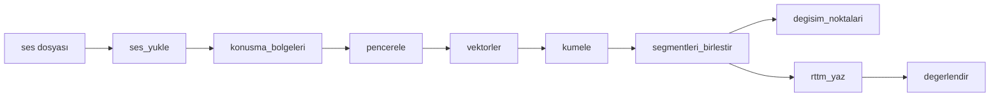

# Modüller Arası Arayüz Sözleşmesi

Bu belge `src/` altındaki modüllerin fonksiyon imzalarını ve veri tiplerini sabitler. Kod taslakları bu belgeyle birebir aynıdır (`python tests/test_arayuz.py` ile kontrol edilir).

## 1. Akış



`src/main.py` bu fonksiyonları sırayla çağırır. Konuşma bölgesi yoksa `pencerele`den sonrası atlanır ve boş RTTM yazılır.

Toplu deneyler (`src/toplu.py`, 3.9) aynı adımları önbellekle çalıştırır: `bolme` (eğitim/değerlendirme yarıları) → önbellek (VAD + MFCC + ECAPA) → eşik taraması ve değişim modeli eğitimi (eğitim yarısı) → E1–E5 (değerlendirme yarısı) → `degerlendir` → CSV ve özet.

## 2. Ortak tipler ve sabitler

| Ad | Tanım |
|---|---|
| `SR` | Örnekleme hızı sabiti: `16000` Hz (`src/ses_girdi.py`) |
| ses | `np.ndarray`, şekil `(n_ornek,)`, `float32`, değerler `[-1, 1]`, mono |
| bölge / pencere | `(baslangic_sn: float, bitis_sn: float)` |
| segment | `(baslangic_sn: float, bitis_sn: float, etiket: str)`, etiket `"spk00"`, `"spk01"`, ... |
| gömme matrisi `X` | `np.ndarray`, şekil `(N, D)`, `float32`; MFCC için `D=26`, ECAPA için `D=192` |
| etiketler | `np.ndarray`, şekil `(N,)`, `int` |

Zaman her yerde **saniye** (float). Sıralama her listede zamana göredir.

## 3. Modüller

### 3.1 `src/ses_girdi.py` (sahibi: Abdullah)

```python
ses_yukle(yol: str) -> tuple[np.ndarray, int]
```
- `yol`: wav/mp3/flac dosya yolu.
- Dönüş: `(ses, 16000)`; ses mono (kanal ortalaması), `float32`, şekil `(n_ornek,)`, RMS yaklaşık -20 dBFS. Tepe değer 0,99'u geçmez (gerekirse RMS -20 dBFS'in altında kalır). wav/flac `soundfile`, mp3 `librosa` ile okunur; 16 kHz dışındaki sesler yeniden örneklenir. Sessiz (sıfır) ses hata değildir, değiştirilmeden döner.
- Hata: `FileNotFoundError` (dosya yok), `ValueError` (bozuk veya desteklenmeyen biçim; mesajda dosya adı geçer).

```python
on_isle(veri: np.ndarray, sr_girdi: int) -> np.ndarray
```
- `ses_yukle`'nin okuma sonrası ön işlemesi: `veri` `(n_ornek,)` veya `(n_ornek, kanal)`; mono, 16 kHz, RMS ≈ -20 dBFS, tepe ≤ 0,99; `float32`, `(n_ornek,)`. Bellekte okunmuş sesler (ör. zip içinden, `src/toplu.py`) aynı işlemden geçsin diye açıktır. Hata: `ValueError` (boş ses, NaN/sonsuz değer, geçersiz örnekleme hızı).

```python
wav_denetle(kaynak: str | bytes, ad: str | None = None) -> float
```
- WAV (RIFF) başlığını standart kütüphaneyle (`struct`) denetler, başlıktaki süreyi (sn) döndürür. `kaynak`: dosya yolu veya dosyanın baytları (zip içinden okunan WAV). `ses_yukle` her `.wav` dosyasında, `toplu.SesKaynagi` her zip kaydında okumadan önce çağırır; soundfile kesik dosyayı hata vermeden kısaltıp okuduğu için bu denetim gereklidir (Hafta 4 duman testi: `bozuk_yarim.wav` çıkış 0 veriyordu).
- `ValueError` (mesajda dosya adı): RIFF/WAVE imzası yok; `fmt` veya `data` bölümü yok ya da `data` `fmt`'den önce; `fmt` alanları geçersiz (kanal / örnekleme hızı / blok hizası 0, blok hizası kanal × örnek genişliğiyle uyuşmuyor); `data`'dan önceki bir bölüm dosya sonunu aşıyor; **`data` bölümünün bildirdiği boyut dosyada kalan bayttan bir örnek çerçevesinden (blok hizası) fazla büyük** (yarıda kesilmiş dosya; mesajda başlıktaki ve gerçek süre).

### 3.2 `src/vad.py` (sahibi: Abdullah)

```python
konusma_bolgeleri(ses: np.ndarray, sr: int) -> list[tuple[float, float]]
```
- `ses`: yukarıdaki ses tipi; `sr`: 16000.
- Dönüş: konuşma bölgeleri (saniye), sıralı, örtüşmeyen. Konuşma yoksa `[]`.
- Silero VAD (`load_silero_vad(onnx=True)`), min. konuşma 250 ms, min. sessizlik 300 ms; model modülde bir kez yüklenir.

### 3.3 `src/oznitelik.py` (sahibi: Abdullah)

```python
pencerele(bolgeler: list[tuple[float, float]], pencere_sn: float = 1.5, kaydirma_sn: float = 0.75) -> list[tuple[float, float]]
vektorler(ses: np.ndarray, sr: int, pencereler: list[tuple[float, float]], yontem: str = "mfcc") -> np.ndarray
```
- `pencerele`: her bölge kendi içinde `pencere_sn` uzunlukta, `kaydirma_sn` adımla pencerelenir; pencere bölge sınırını aşmaz. `pencere_sn`den kısa bölge tek pencere olur. Bölgenin sonu açıkta kalırsa son pencere bölge sonuna hizalanır (bölgenin tamamı kapsanır). Boş girdi için `[]`. Hata: `ValueError` (`pencere_sn <= 0` veya `kaydirma_sn <= 0`).
- `vektorler`: `yontem` `"mfcc"` (13 katsayının ortalaması + std, `D=26`) veya `"ecapa"` (`D=192`). Dönüş şekli `(N, D)`, `float32`, `N = len(pencereler)`; pencere yoksa `(0, D)`. Hata: `ValueError` (bilinmeyen `yontem`).
  - `"mfcc"`: librosa MFCC, `n_fft=512`, `win_length=400`, `hop_length=160`. **c0 (enerji) atılır, c1–c13 kullanılır** (`n_mfcc=14` hesaplanıp ilki düşülür); 13 katsayının ortalaması + std = 26 boyut.
  - `"ecapa"`: SpeechBrain `speechbrain/spkrec-ecapa-voxceleb` (`speechbrain.inference.speaker.EncoderClassifier`), pencereler toplu işlenir, GPU varsa kullanılır.

```python
ecapa_modeli(onbellek: str | None = None) -> EncoderClassifier
```
- ECAPA modelini bir kez yükler, modülde saklar ve döndürür. Model klasörü: `onbellek` parametresi, yoksa `KT_MODEL_ONBELLEK` ortam değişkeni, o da yoksa `~/.cache/konusmaci-tespiti/ecapa`. Colab'da modeli Drive'daki bir klasörden önceden yüklemek için kullanılır; model zaten yüklüyse `onbellek` yok sayılır.

```python
olcek_hesapla(X_listesi: list[np.ndarray]) -> dict
olcekle(X: np.ndarray, olcek: dict | None) -> np.ndarray
```
- **MFCC genel standartlaştırma.** `olcek_hesapla`: verilen tüm matrislerin pencerelerinden boyut başına ortalama ve standart sapma (std alt sınırı 1e-8); dönüş `{"ortalama": [D], "std": [D], "pencere_sayisi": n}`. Hata: `ValueError` (hiç pencere yok). `olcekle`: `(X - ortalama) / std`, `float32`; `olcek` `None` ise `X` değişmez.
- Ölçek **yalnızca eğitim yarısının** tüm MFCC pencerelerinden hesaplanır ve değerlendirme yarısında aynısı kullanılır. **Kayıt başına ortalama çıkarılmaz** (tek konuşmacılı kayıtları bölebilir). Gerekçe: c0'sız MFCC ortalama+std vektörleri ortak bir yönde toplanır, L2 normalize kosinüs mesafeleri çok küçük kalır (Hafta 4 duman testi: 0,5 eşikle her kayıtta 1 konuşmacı). Ölçek önbelleğe yazılmaz; önbellekte ham MFCC durur.
- Uygulandığı yerler: E1/E2 kümelemesi (`esikler.json` → `mfcc_olcek`), eşik taraması (MFCC), değişim modelinin `mfcc_cos` özelliği (`degisim_modeli.joblib` → `mfcc_olcek`). `src/main.py` tek dosya komutu MFCC'de `src/varsayilanlar.json` içindeki ölçeği uygular (3.12).

### 3.4 `src/kumeleme.py` (sahibi: Cevat)

```python
kumele(X: np.ndarray, konusmaci_sayisi: int | None = None, esik: float | None = None) -> np.ndarray
```
- Yöntem: ortalama bağlantılı AHC, kosinüs mesafesi (gerekçe: Hafta2 C-4 bölümü).
- `X`: `(N, D)`, `float32`. `konusmaci_sayisi`: biliniyorsa verilir, `None` ise `esik` ile otomatik kestirilir (tek konuşmacıda 1 küme çıkabilir, TG-6). `esik`: kosinüs mesafesi eşiği, `None` ise `VARSAYILAN_ESIK` (VoxConverse dev üzerinde ayarlanacak, KG-3).
- Vektörler önce L2 ile normalize edilir. `konusmaci_sayisi` verilirse scipy `fcluster(criterion="maxclust")`, verilmezse `criterion="distance"` kullanılır.
- `VARSAYILAN_ESIK` = `varsayilanlar.esik("ecapa")` (0,79346; Hafta 4'te VoxConverse dev eğitim yarısında ayarlandı, 3.12). `kumele` yöntemi bilmediği için `esik=None`'da varsayılan yöntemin (ECAPA) eşiğini kullanır; MFCC eşiği `varsayilanlar.esik("mfcc")` (0,77122) ile çağıran tarafından verilir (`main`, `toplu`).
- Dönüş: `(N,)` `int` etiketler (`0..K-1`). `N == 0` ise boş dizi, `N == 1` ise `[0]`.
- Hata: `ValueError` (`X` iki boyutlu değil veya `konusmaci_sayisi < 1`).

### 3.5 `src/cikti.py` (sahibi: Cevat)

```python
segmentleri_birlestir(pencereler: list[tuple[float, float]], etiketler: np.ndarray, ada_esik_sn: float = 1.0, bosluk_sn: float = 0.3) -> list[tuple[float, float, str]]
degisim_noktalari(segmentler: list[tuple[float, float, str]]) -> list[float]
rttm_yaz(segmentler: list[tuple[float, float, str]], dosya_id: str, yol: str) -> None
rttm_oku(yol: str) -> list[tuple[float, float, str]]
tablo_yazdir(segmentler: list[tuple[float, float, str]]) -> str
```
- `segmentleri_birlestir`: ardışık aynı etiketli pencereler tek segmentte birleşir. Örtüşen farklı etiketli iki pencerede sınır, örtüşmenin ortasıdır. Önce süresi `ada_esik_sn`'den kısa ve iki yanı aynı etiketli koşular (A-B-A) komşu etikete katılır (KG-10); en kısa koşu önce işlenir. Ada yumuşatmada komşuluk segment sırasına göredir; segmentler arasındaki sessizlik boşluğu dikkate alınmaz. Aynı etiketli iki segment arasındaki boşluk en fazla `bosluk_sn` ise (≤ 0,3 sn, VAD min. sessizlikle aynı) birleşir; daha uzun boşluk segmente girmez (KG-11). Etiketler toplam konuşma süresine göre azalan sırada `spk00`, `spk01`, ... diye adlandırılır. Hata: `ValueError` (`len(pencereler) != len(etiketler)`).
- `degisim_noktalari`: ardışık iki segmentin etiketi farklıysa ikincinin başlangıcı (saniye, artan). 0 veya 1 segmentte `[]`. Hesap milisaniye çözünürlüğünde, aşağıdaki ortak tanımla yapılır. Örtüşmeyen segmentlerde (sistem çıktısı) sonuç yukarıdaki cümleyle aynıdır. Örtüşen segmentlerde (referans RTTM) örtüşen aralıklar atılır.
- `rttm_yaz`: 10 alanlı RTTM, `SPEAKER <dosya_id> 1 <başlangıç> <süre> <NA> <NA> <etiket> <NA> <NA>`; alan 5 süredir (bitiş değil), 3 ondalık. `dosya_id` uzantısız dosya adıdır. Segment yoksa boş dosya yazar. Hata: `OSError`.
- `rttm_oku`: dosyadaki sırayla `(bas, bit, etiket)` döner (`bit = bas + süre`). Boş dosyada `[]`. Boş satırlar, `;` veya `#` ile başlayan satırlar ve `SPEAKER` dışındaki satırlar atlanır; süresi 0 olan segment atlanır. Hata: `FileNotFoundError`, `ValueError` (satır biçimi bozuk: 8'den az alan, sayısal olmayan başlangıç/süre, negatif zaman veya süre).
- `tablo_yazdir`: `Konuşmacı | Başlangıç | Bitiş | Süre` sütunlu metin, zamanlar `dd:ss.mmm` (dakika:saniye.milisaniye); altında konuşmacı başına toplam süre ve yüzde (KG-14).

**Ortak değişim noktası tanımı** (yalnızca standart kütüphane, tüm zamanlar tamsayı milisaniye). `degisim_noktalari`, `src/degerlendirme.py` ve `data/tools/rttm_istatistik.py` bu iki fonksiyonu kullanır; tanım başka yerde kopyalanmaz.

```python
temel_araliklar(segmentler_ms: list[tuple[int, int, str]]) -> list[tuple[int, int, frozenset]]
tek_konusmaci_segmentleri(segmentler_ms: list[tuple[int, int, str]]) -> list[tuple[int, int, str]]
```
- `temel_araliklar`: zaman eksenini segment sınırlarına göre böler; her aralık için etkin etiket kümesini verir (boş küme = sessizlik).
- `tek_konusmaci_segmentleri`: örtüşen (≥ 2 konuşmacı) ve sessiz aralıkları atar; aynı konuşmacının ardışık tek konuşmacılı aralıklarını (arada sessizlik veya örtüşme olsa bile) birleştirir. Ardışık iki çıktı segmentinin etiketi farklıdır; ilki hariç her segmentin başlangıcı bir değişim noktasıdır.

### 3.6 `src/degerlendirme.py` (sahibi: Sefkan)

```python
degerlendir(ref_rttm: str, hyp_rttm: str, collar: float = 0.5, tolerans_sn: float = 0.5) -> dict
```
- `collar`: pyannote.metrics biçiminde tam genişlik (0.5 = ±0,25 sn). `tolerans_sn`: değişim noktası eşleşme toleransı.
- DER ve JER pyannote.metrics ile, `skip_overlap=False` (örtüşen konuşma dahil) hesaplanır. Değerlendirme bölgesi (UEM) dosya başından (0 sn) referans ve tahmindeki en geç bitişe kadardır.
- Dönüş sözlüğü:

| Anahtar | Tip | Anlamı |
|---|---|---|
| `der`, `jer` | float | Oran (0.25 = %25). Referansta konuşma yoksa (`referans_sn == 0`) **NaN** |
| `yanlis_alarm_sn` | float | Yanlış alarm süresi (sn) |
| `kacirilan_sn` | float | Kaçırılan konuşma süresi (sn) |
| `karisiklik_sn` | float | Konuşmacı karışıklığı süresi (sn) |
| `referans_sn` | float | pyannote `total`: collar dışındaki referans konuşma süresi, örtüşmede konuşmacı başına sayılır. Tüm kayıtlar için DER = Σ(yanlis_alarm + kacirilan + karisiklik) / Σ referans_sn |
| `f1`, `precision`, `recall` | float | Değişim noktası F1 / kesinlik / duyarlık (0-1) |
| `tp`, `fp`, `fn` | int | Eşleşen, fazla ve kaçırılan değişim noktası sayısı (tüm kayıtlarda mikro F1 için) |

- Değişim noktaları referans ve tahmin RTTM'inden `cikti.degisim_noktalari` (ortak tanım, 3.5) ile çıkarılır. Her referans noktası en fazla bir tahminle eşleşir; `|r - h| <= tolerans_sn` olan çiftlerden en yakınları önce eşleşir.
- Kenar durumlar: tahminde değişim noktası yoksa `precision = 1`, referansta yoksa `recall = 1`; `precision + recall == 0` ise `f1 = 0`. Sessiz referans + değişimsiz tahmin: `f1 = 1`. Sessiz referans + sahte değişimler: `f1 = 0`. Bu yüzden toplu sonuçta dosya ortalaması yerine `tp/fp/fn` toplamlarıyla mikro F1 kullanılır.
- Hata: `FileNotFoundError`, `ValueError` (RTTM biçimi bozuk; ayrıca `collar < 0` veya `tolerans_sn < 0`).

### 3.7 `src/main.py` (sahibi: Cevat)

```python
main(argv: list[str] | None = None) -> int
```
Komut satırı: `python -m src.main <girdi_ses> -o <cikti.rttm> [--yontem ecapa|mfcc] [--konusmaci-sayisi N] [--esik E]`

- `--yontem`: varsayılan **`ecapa`** (Hafta 4 değerlendirme yarısında en iyi sonuç: E4, DER 0,061). `mfcc` seçenek olarak kalır.
- `--esik`: AHC kosinüs mesafesi eşiği. Verilmezse (ve `--konusmaci-sayisi` yoksa) yöntemin ayarlanmış eşiği kullanılır: `varsayilanlar.esik(yontem)` (ecapa 0,79346, mfcc 0,77122). `--konusmaci-sayisi` verilirse eşik kullanılmaz.
- MFCC'de vektörler kümelemeden önce `varsayilanlar.mfcc_olcek()` ile standartlaştırılır; ölçek henüz dosyada yoksa ham MFCC kullanılır ve uyarı yazılır.

| Çıkış kodu | Anlamı |
|---|---|
| 0 | Başarılı (sessiz dosyada boş RTTM de başarılıdır) |
| 1 | Girdi hatası: `FileNotFoundError` veya `ValueError`; stderr'e dosya adı içeren mesaj yazılır |
| 2 | İç hata: diğer tüm istisnalar |

```python
kisa_konusma(bolgeler: list[tuple[float, float]]) -> bool
hat_segmentleri(bolgeler, pencereler, X, konusmaci_sayisi=None, esik=None) -> list[tuple[float, float, str]]
```
- `kisa_konusma`: toplam konuşma `MIN_KONUSMA_SN` (1,5 sn) altında mı.
- `hat_segmentleri`: konuşma yoksa `[]`; kısa konuşmada kümeleme atlanır, her bölge `spk00` olur (`pencereler` ve `X` kullanılmaz); aksi halde `kumele` + `segmentleri_birlestir`. `main` ve `toplu` aynı kuralı bu fonksiyonla uygular.

### 3.8 `src/bolme.py` (sahibi: Sefkan)

```python
grup(sayi: int) -> str
konusmaci_sayilari(rttm_dizin: str) -> dict[str, int]
bol(sayilar: dict[str, int], seed: int = 68) -> tuple[list[str], list[str]]
liste_yaz(kayitlar: list[str], yol: str) -> None
liste_oku(yol: str) -> list[str]
```
Komut satırı: `python -m src.bolme --rttm-dizin <voxconverse/dev> --cikti-dizin <klasor> [--seed 68]` → `egitim.txt`, `degerlendirme.txt`.
- `grup`: `"1"` (0 veya 1 konuşmacı), `"2"`, `"3-4"`, `"5+"`.
- `konusmaci_sayilari`: klasördeki her `<kayit>.rttm` için farklı etiket sayısı; kayıt kimliği dosya adıdır. Hata: `FileNotFoundError` (klasör yok), `ValueError` (RTTM bozuk).
- `bol`: tabakalı bölme. Her tabaka sıralanır, `random.Random(seed)` ile karıştırılır ve ikiye ayrılır; tek sayılı tabakalarda artan kayıt sırayla bir eğitime, bir değerlendirmeye verilir. Dönüş: `(egitim, degerlendirme)`, ikisi de sıralı. Aynı girdi her zaman aynı bölmeyi verir.
- `liste_oku`: boş satırlar ve `#` ile başlayanlar atlanır.

### 3.9 `src/toplu.py` (sahibi: Sefkan)

Komut satırı (bir iş seçilir; çıkış kodu 0 başarılı, 1 girdi hatası veya en az bir kayıt hatalı, 2 iç hata):

```text
python -m src.toplu --deney E1|E2|E3|E4|E5 --zip Z --rttm-dizin R --liste L [L ...] --cikti-dizin C --onbellek O [--esik X | --esikler J] [--model M]
python -m src.toplu --onbellek-doldur --zip Z --liste L [L ...] --onbellek O [--yontemler mfcc ecapa] [--cikti-dizin C]
python -m src.toplu --esik-tara --zip Z --rttm-dizin R --liste L --onbellek O --esikler J [--cikti-dizin C]
python -m src.toplu --model-egit --zip Z --rttm-dizin R --liste L --onbellek O --model M [--cikti-dizin C]
```

| Deney | Öznitelik | Konuşmacı ataması |
|---|---|---|
| E1 | MFCC | AHC, konuşmacı sayısı referans RTTM'den |
| E2 | MFCC | AHC, eşikle |
| E3 | ECAPA | AHC, konuşmacı sayısı referans RTTM'den |
| E4 | ECAPA | AHC, eşikle |
| E5 | ECAPA (+ MFCC özelliği) | Değişim modeli segmentleri + AHC (ECAPA eşiğiyle) |

Eşik önceliği (E2/E4/E5): `--esik` > `--esikler` dosyasındaki yöntem eşiği > `varsayilanlar.esik(yontem)` (E5: ecapa). E1/E2'de MFCC ölçeği önceliği: `--esikler` dosyasının `mfcc_olcek` alanı > `varsayilanlar.mfcc_olcek()`; ikisi de yoksa ham MFCC kullanılır ve uyarı yazılır. `deney_calistir` doğrudan çağrılırsa `esik=None` yöntemin ayarlanmış eşiği, `mfcc_olcek=None` ham MFCC demektir.

```python
class SesKaynagi(zip_yol)                       # .oku(kayit) -> (ses, 16000); bağlam yöneticisi
onbellek_anahtarlari() -> dict[str, str]
onbellek_yolu(onbellek: str, tur: str, kayit: str) -> str
ozellik_al(kaynak, kayit, onbellek, yontemler=("mfcc", "ecapa")) -> dict
onbellek_doldur(zip_yol, kayitlar, onbellek, yontemler=("mfcc", "ecapa"), gunluk_dizin=None, log=print) -> dict
deney_calistir(zip_yol, rttm_dizin, kayitlar, deney, cikti_dizin, onbellek, esik=None, model_yolu=None, mfcc_olcek=None, log=print) -> dict
esik_tara(zip_yol, rttm_dizin, kayitlar, onbellek, yontemler=("mfcc", "ecapa"), izgara=None, gunluk_dizin=None, log=print) -> dict
yuzdelik_izgarasi(yukseklikler, n: int = 40) -> list[float]
esikleri_yaz(yol: str, sonuc: dict) -> None
esikleri_oku(yol: str) -> dict
model_egit(zip_yol, rttm_dizin, kayitlar, onbellek, model_yolu, gunluk_dizin=None, log=print) -> dict
ozet_hesapla(satirlar: list[dict]) -> dict
ozet_yaz(yol: str, ozet: dict) -> None
listeleri_oku(yollar: list[str]) -> list[str]
main(argv: list[str] | None = None) -> int
```
- **Ses okuma:** WAV zip'ten `ZipFile.read` ile belleğe alınır ve `soundfile` ile `BytesIO`'dan okunur; zip açılmaz. Okunamazsa geçici dosyaya yazılıp `ses_yukle` ile okunur ve silinir. Ön işleme `ses_girdi.on_isle` ile `ses_yukle` ile aynıdır.
- **Önbellek:** `{onbellek}/<tur>/<anahtar>/<kayit>.npz`, `tur` ∈ {`vad`, `mfcc`, `ecapa`}. `<anahtar>` hesaplamayı etkileyen parametreleri içerir (ör. `p1.5_k0.75_v250_s300_mfcc13c1_f512_w400_h160`); her anahtar klasöründe `parametreler.json` durur. `vad` dosyası: `bolgeler (K, 2)`, `ses_sn`, `sure_sn`. `mfcc`/`ecapa` dosyası: `pencereler (N, 2)`, `X (N, D) float32`, `sure_sn`. Dosya önce geçici adla yazılıp `os.replace` ile konur; yarım dosya geçerli sayılmaz, okunamayan dosya yeniden hesaplanır.
- **Kayıt CSV'si** `{cikti}/<deney>.csv`, ilk beş sütun sabit: `deney, kayit, der, jer, f1`; ardından `precision, recall, tp, fp, fn, yanlis_alarm_sn, kacirilan_sn, karisiklik_sn, referans_sn, ses_sn, sure_sn`. `sure_sn` = öznitelik hesaplama süresi (önbellekte saklı) + deneyin kendi süresi. Hipotez RTTM'leri `{cikti}/<deney>/<kayit>.rttm`. CSV'de olan kayıtlar yeniden çalıştırmada atlanır. Değerlendirme `collar=0.5`, `tolerans_sn=0.5`.
- **Özet** `{cikti}/ozet.csv` sütunları: `deney, kayit_sayisi, der, jer_ort, mikro_f1, toplam_sure_sn, toplam_ses_sn, atlanan`. `der` = Σ(yanlış alarm + kaçırılan + karışıklık) / Σ `referans_sn`; `jer_ort` NaN'lar dışarıda ortalama; `mikro_f1` Σtp/Σfp/Σfn'den. Aynı deneyin satırı yeniden çalıştırmada değiştirilir.
- **Hatalar:** hata veren kayıt atlanır, `{cikti}/hata_gunlugu.txt` dosyasına yazılır (`--cikti-dizin` yoksa önbellek klasörüne), iş sürer.
- **`esik_tara` (veriden ızgara):** yöntem başına eğitim kayıtlarının AHC birleşme yükseklikleri (bağlantı mesafeleri) toplanır; aday eşikler bunların `YUZDELIK_SAYISI` = 40 yüzdeliğidir (`yuzdelik_izgarasi`): %1–%99 arası, `q = 100 − geomspace(99, 1, 40)` ile üst uca doğru sıklaşır, çünkü konuşmacılar arası birleşmeler her kaydın en yüksek birkaç birleşmesidir. MFCC önce genel ölçekle standartlaştırılır. Bağlantı ağacı kayıt başına bir kez kurulur, her eşikte kesilir. Seçim: en düşük toplam DER, eşitlikte büyük eşik. **En iyi eşik ızgaranın kenarına düşerse** o yönde genişletilip yeniden taranır (1. tur: %0,01–%1 veya %99–%99,99 yüzdelikleri ve en küçük yüksekliğin 0,9 katı / en büyüğün 1,01 katı; sonraki turlar: kenar değerin 0,8/0,6/0,4 veya 1,1/1,25/1,5 katı, en çok 2,0; en çok `GENISLETME_TURU` = 3 tur); her genişletme ve hâlâ kenarda kalma `uyarilar`'a yazılır. `izgara` açıkça verilirse yalnızca o değerler taranır, genişletme yapılmaz.
- `esikler.json`: `{"mfcc": x, "ecapa": y, "mfcc_olcek": {"ortalama", "std", "pencere_sayisi"}, "tarama": [{yontem, esik, der, jer_ort, mikro_f1}], "izgara": {yontem: [...]}, "genisletme": {yontem: n}, "kayit_sayisi", "hatali", "uyarilar", "collar", "tarih"}`.

### 3.10 `src/degisim_modeli.py` (sahibi: Sefkan)

```python
OZELLIK_SURUMU = "v2"
OZELLIKLER = ("ecapa_cos", "ecapa_baglam_cos", "ecapa_atlamali_cos", "mfcc_cos", "bosluk_sn", "ayni_bolge")
ozellikler(pencereler, X_ecapa, X_mfcc, bolgeler, k: int = 3) -> np.ndarray          # (N-1, 6) float32
cift_zamanlari(pencereler) -> np.ndarray                                             # (N-1,)
baskin_konusmacilar(pencereler, ref_segmentler, oran: float = 0.5) -> list[str | None]
cift_etiketleri(baskin: list) -> tuple[np.ndarray, np.ndarray]                       # (y, maske)
tepeler(olasiliklar, zamanlar, esik: float, min_aralik_sn: float) -> list[float]
kayit_verisi(kayit, pencereler, X_ecapa, X_mfcc, bolgeler, ref_segmentler, k: int = 3) -> dict
egit(veriler: list[dict], seed: int = 68, n_kat: int = 5, log=print) -> dict
kaydet(paket: dict, yol: str) -> None
yukle(yol: str) -> dict
degisim_tahmin(paket, pencereler, X_ecapa, X_mfcc, bolgeler) -> list[float]
bolgeleri_kes(bolgeler, degisimler) -> list[tuple[float, float]]
e5_segmentleri(paket, bolgeler, pencereler, X_ecapa, X_mfcc, esik: float | None = None) -> list[tuple[float, float, str]]
```
- **Özellikler** (ardışık pencere çifti i, i+1; sürüm `v2`, sıra sabit): `ecapa_cos` = cos(eᵢ, eᵢ₊₁); `ecapa_baglam_cos` = cos(ort(eᵢ₋ₖ₊₁..eᵢ), ort(eᵢ₊₁..eᵢ₊ₖ)), k=3, dizi sınırında kırpılır; `ecapa_atlamali_cos` = cos(eᵢ₋₁, eᵢ₊₂); `mfcc_cos` = cos(mᵢ, mᵢ₊₁), m genel ölçekli MFCC (v2; v1'de ham MFCC); `bosluk_sn` = sᵢ₊₁ − bᵢ (negatif = örtüşme); `ayni_bolge` = iki pencerenin merkezi aynı VAD bölgesinde mi. ECAPA vektörleri L2 ile normalize edilir.
- **Etiket tanımı:** her pencerenin *baskın konuşmacısı*, referans RTTM'de pencereyle en çok örtüşen konuşmacıdır (aynı konuşmacının segmentleri birleştirilerek ölçülür; eşitlikte alfabetik ilk). Baskın konuşmacı pencerenin **yarısından azını** kaplıyorsa pencere *belirsizdir* (`None`). Çift etiketi: baskın konuşmacılar farklıysa 1, aynıysa 0. Pencerelerden biri belirsizse çift eğitimden çıkarılır (`maske = False`).
- **Değişim zamanı:** çiftin örtüşme bölgesinin ortası, `(bᵢ + sᵢ₊₁) / 2`; pencereler arasında boşluk varsa aynı formül boşluğun ortasını verir.
- **Tepe seçme:** olasılığı eşiği geçen yerel tepeler; en yüksek olasılıklı tepe önce seçilir, seçilmiş bir tepeye `min_aralik_sn`'den yakın olanlar bastırılır.
- **Eğitim (`egit`):** yalnızca eğitim yarısı. Adaylar: lojistik regresyon (`StandardScaler`, `class_weight="balanced"`, C ∈ {0,1; 1; 10}) ve MLP (`StandardScaler`, gizli (32) veya (64, 32), alpha ∈ {1e-4, 1e-3}, `early_stopping`). Seçim: kayıt bazında gruplu 5 katlı çapraz doğrulamada (`GroupKFold`) ortalama kesinlik (average precision); eşitlikte listede önce gelen. Seçilen model tüm eğitim yarısında yeniden eğitilir. Tepe ayarları seçilen modelin kat dışı olasılıklarıyla taranır: olasılık eşiği 0,10–0,90 (0,05 adım) × en küçük aralık {0,5; 1; 1,5; 2} sn; ölçüt ±0,5 sn toleranslı mikro değişim F1'i. Hata: `ValueError` (< 2 etiketli kayıt veya tek sınıf).
- **Paket** (joblib, tek dosya): `model` (ölçekleyici içeren sklearn pipeline), `secilen_model`, `mfcc_olcek` (eğitim yarısından genel MFCC ölçeği; `degisim_tahmin` ham MFCC'ye bunu uygular), `ozellik_surumu`, `ozellikler`, `baglam_k`, `baskin_oran`, `olasilik_esigi`, `min_aralik_sn`, `tolerans_sn`, `egitim_f1`, `tepe_tarama`, `uyarilar` (seçilen olasılık eşiği veya en küçük aralık ızgaranın kenarındaysa uyarı metinleri; eşik taramasındaki mantık), `cv` (aday başına `ap_ort`, `ap_std`, `katlar`), `egitim_tarihi`, `egitim_kayit_sayisi`, `egitim_cift_sayisi`, `degisim_orani`, `sklearn_surumu`, `seed`. `yukle`, özellik sürümü uyuşmazsa `ValueError` verir. Model dosyası repoya girmez.
- **E5 (`e5_segmentleri`):** VAD bölgeleri, içlerine düşen tahmin edilmiş değişim noktalarından parçalara bölünür (VAD sınırları da segment sınırıdır). Her parçanın vektörü, merkezi parçanın içine düşen pencerelerin normalize ECAPA ortalamasıdır (hiç yoksa en yakın pencere). Parçalar `kumele(V, None, esik)` ile etiketlenir ve `segmentleri_birlestir`'den geçer. Sessizlik ve kısa konuşma kuralları `hat_segmentleri` ile aynıdır.

### 3.11 `src/uyumluluk.py` (sahibi: Sefkan)

```python
speechbrain_hazirla() -> list[str]
```
- **Neden:** speechbrain 1.0.3, içe aktarılırken (`speechbrain/dataio/dataio.py` modül düzeyinde `check_torchaudio_backend()`) `torchaudio.list_audio_backends()` çağırır. Bu fonksiyon torchaudio 2.9'da kaldırıldı; Colab'daki torch/torchaudio 2.11 ile `import speechbrain…` `AttributeError` verir. Aynı kontrol torchaudio < 2.1 için `set_audio_backend()` çağırır.
- **Ne yapar:** `torchaudio`'yu içe aktarır; `list_audio_backends` yoksa `["soundfile"]` döndüren, `set_audio_backend` yoksa hiçbir şey yapmayan bir fonksiyon atar. Var olan fonksiyonlara dokunmaz, tekrar çağrılabilir. Dönüş: bu çağrıda eklenen adlar. Hata: `ImportError` (torchaudio yok).
- **Kural:** speechbrain'i içe aktaran her yer önce bunu çağırır: `oznitelik.ecapa_modeli`, `tests/kurulum_kontrol.py`, `tests/test_oznitelik.py`, defterin 1. bölümü.
- **Etkisi yok:** speechbrain v1.0.3 kaynağında kontrol edildi: `EncoderClassifier.from_hparams` (`Fbank`, `InputNormalization`, `ECAPA_TDNN`, `CategoricalEncoder`, `Pretrainer`) ve `encode_batch` akışında başka `torchaudio` çağrısı yoktur. `torchaudio.load` yalnızca `load_audio` / `classify_file` gibi dosya yolu alan yardımcılarda geçer; hattımız sesi `soundfile`/`librosa` ile okuyup ECAPA'ya tensör verir, bunları kullanmaz.

### 3.12 `src/varsayilanlar.py` ve `src/varsayilanlar.json` (sahibi: Sefkan)

```python
yukle() -> dict
esik(yontem: str) -> float
mfcc_olcek() -> dict | None
```
- `src/varsayilanlar.json`, eğitim yarısında ayarlanan değerlerin tek kaynağıdır: `{"kaynak", "tarih", "esik": {"mfcc", "ecapa"}, "mfcc_olcek": {"ortalama": [26], "std": [26], "pencere_sayisi"} | null}`. Değerler `src.toplu --esik-tara` çıktısından (`esikler.json`) alınır; defterin 10. bölümü bu dosyanın içeriğini tek satırlık JSON olarak basar ("REPO SABİTLERİ").
- `yukle`: dosyayı bir kez okur ve denetler. Hata: `ValueError` (iki yöntemin eşiği yok veya pozitif değil; `mfcc_olcek` 26 ortalama ve 26 pozitif std içermiyor). `esik`: yöntemin eşiği; bilinmeyen yöntemde `ValueError`. `mfcc_olcek`: ölçek veya henüz doldurulmadıysa `None`.
- Kullananlar: `kumeleme.VARSAYILAN_ESIK`, `main.calistir`, `toplu.deney_calistir` ve `toplu` komut satırı (`--esikler` verilmediğinde).
- Hafta 4 değerleri (tarama tarihi 2026-10-27): eşik mfcc 0,77122, ecapa 0,79346 (eşik taramasında uyarı yok); MFCC ölçeği eğitim yarısının 42 520 penceresinden (26 ortalama, 26 std).

## 4. Kenar durumlar

- **Kısa dosya / kısa konuşma (1,5 sn'den az):** Hata verilmez. Uyarı yazılır, tüm konuşma tek segment sayılır, tek konuşmacı (`spk00`) atanır, çıkış kodu 0. Bu durumda `main` kümelemeyi hiç çağırmaz; VAD bölgelerinin her biri `spk00` etiketiyle doğrudan segment olur. (Ayrıca `kumele`, `N == 1` için `[0]` döner.)
- **Sessiz dosya:** `konusma_bolgeleri` `[]` döner, `main` boş RTTM yazar, çıkış kodu 0.
- **Bozuk veya desteklenmeyen dosya:** `ses_yukle` `ValueError` fırlatır (dosya yoksa `FileNotFoundError`); `main` çıkış kodu 1 ile döner ve mesajda dosya adı bulunur.
- **Örtüşen konuşma:** İlk sürümde tespit edilmez; her segment tek konuşmacıya atanır. Bilinen sınırlamadır.
- **Maksimum süre (300 sn):** Açık nokta, ekip toplantısında karara bağlanacak.

## 5. Değişiklik kuralı

İmza, tip veya hata davranışı değişikliği önce **bu dosyada PR ile** yapılır, onaylanınca kod uyarlanır. Taslak kodlar ve `tests/test_arayuz.py` bu belgeyle aynı kalmalıdır.
